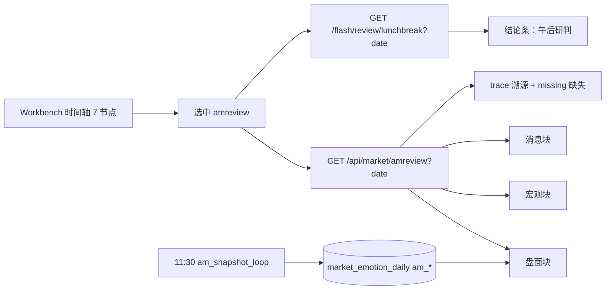

## 需求概述

把工作台时间轴里代表 09:30 的「盘中」改名为「早盘」，并在其与「午盘」之间新增「早盘复盘」节点。新节点用结构化数据加文字结论的方式，系统说明当日早盘走势、宏观面和消息面，用于研判午后行情，并保证两个节点切换顺滑、内容可追溯。

## 核心功能

- 时间轴由 6 个节点改为 7 个：盘前 09:10 → 竞价 09:15 → 早盘 09:30 → 早盘复盘 11:30 → 午盘 13:00 → 盘后 15:00 → 复盘 19:30
- 「盘中」节点文字改为「早盘」，配色与位置不变，点击行为、看盘序、涨停梯队等内容保持原样
- 新增「早盘复盘」节点，页面自上而下分为四块：

1. 结论条：午后研判（复用已有午盘 LLM 复盘，首行结论置顶、依据可展开）
2. 盘面走势：指数涨跌、涨跌家数、涨跌停、半日成交额（含与昨日同期对比）、板块强弱
3. 宏观面：外盘四件套、市场状态（regime）、当日已公布的经济数据（实际值、预期、方向）
4. 消息面：早盘重要快讯时间线及要点归纳

- 每块内容都带数据来源与数据时点（as_of）标注；页面底部提供「口径与溯源」清单，逐项说明数据来自哪张表或接口、截至几点
- 历史日期回放：选中历史日时只读已落库快照，缺失项显式显示「该日未留存」，不使用今日数据填充
- 切换体验：节点间切换不整页刷新，数据按日缓存，首次进入显示骨架占位；11:32 复盘文本生成后自动补上

## 技术栈

- 前端：Vue 3 + Vite + Tailwind（沿用现有，不引入新依赖）
- 后端：FastAPI + 现有 `app.database` 双库封装（SQLite/PostgreSQL）
- 数据源：全部复用现有模块，不新增外站请求

## 实现方案

### 1. 阶段模型 6 → 7

`frontend/src/views/Workbench.vue` 的 `PHASES` 增加 `amreview`（早盘复盘，11:30），`intraday` 标签改「早盘」，`midday` 时间改 13:00。
`computePhase()` 分界改为：570-690 早盘 / 690-780 早盘复盘 / 780-900 午盘 / 900-1170 盘后。时间轴 7 节点，网格改 `grid-cols-4 md:grid-cols-7`（手机 4+3 两行），并同步模板上方注释。

### 2. 早盘必须"定稿"，不能读实时

关键正确性问题：下午 15:00 点开「早盘复盘」时，内存池里已是收盘价，直接读实时就会把下午数据当成早盘。

因此新增早盘定稿快照：

- 在 `market_emotion_daily` 幂等加列 `am_as_of / am_up / am_down / am_limit_up / am_limit_down / am_amount_yi`（TEXT，沿用 `_EMOTION_CLOSE_COLS` 的 ALTER 循环）
- 新增 `am_snapshot_loop`：交易日 11:30-11:40 写一次，幂等（`mark_schedule_done`），守卫必须用 `rules.is_trading_day()`
- 落库失败不阻断，端点回退实时值并在 `caliber` 字段标注「实时值，非 11:30 定稿」

### 3. 单一聚合端点，避免前端串行请求

新增 `GET /api/market/amreview?date=YYYY-MM-DD`，一次返回三块数据、溯源清单与缺失清单。
理由：Supabase 在 ap-southeast-1，单次往返约 570ms；前端拼 6 个接口会串成 3 秒以上。聚合端点内部并发取数（`asyncio.to_thread` + `gather`），并加 300 秒进程缓存（11:30 后数据冻结，缓存不损新鲜度）。

数据映射：

| 块 | 今日 | 历史回放 |
| --- | --- | --- |
| 盘面 | `am_*` 定稿列优先；指数走 `/market/overview` 的 3 秒缓存；成交额走 `market_amount_daily.series_json` 截到 11:30 | 同左（`series_json` 可截半日）；`am_*` 缺失则回退 `close_*` 并标注口径 |
| 宏观 | `app/macro.py`（60 秒缓存）+ `/market/temperature` 的 regime + `/flash/calendar` 已公布项 | `market_regime_history` + `macro_daily_history` 按日取 |
| 消息 | `store.load_raw_items()`（120 秒缓存）+ `/flash/diagnosis` 最新一条 | `flash_brief` 按日期取（`/flash/brief?date=`，只读不烧 LLM） |
| 结论 | `/flash/review/lunchbreak` | 同接口加 `date` 参数，按日落库记录取 |


### 4. 复盘按日期取

`/flash/review/{phase}` 增加可选 `date` 参数（不传保持现有"最新一条"语义，向后兼容）；`store.py` 增加按日期过滤 `flash_reviews.time` 的读取函数。

### 5. 切换与轮询

- 复用 `_dayCached` 按日缓存，节点来回切不重复拉取
- 11:30-13:00 期间：行情不轮询（数据已冻结），仅对复盘文本做 60 秒轻轮询（最多 5 次），取到即停
- 不复用 `briefMd`（多阶段共用单个 ref，会串味），新开独立 ref

## 实施要点

- 观点文本必须走 `class="md-body"` + `renderMd`，禁止 `whitespace-pre-wrap` 裸文本
- Tailwind 类名全部静态字面量；新节点配色用青色系，避开红/绿（红涨绿跌语义已被占用）
- 新端点严格计数查询：回放路径不超过 6 次往返，必须合并为按日批量查询
- 历史缺失一律显式标注，绝不为展示现场重算（11-01 已发生 114 秒重算事故）
- 不改任何交易信号、门槛、仓位逻辑，不触发 `SIGNAL_RULE_VERSION`

## 架构



## 目录结构

```
frontend/src/views/Workbench.vue            # [MODIFY] PHASES/PHASE_STYLE 增加 amreview、盘中改早盘、午盘改 13:00；
                                            #   computePhase 与 isLivePhase 分界；时间轴改 7 列；loadPhaseData 增 amreview 分支；
                                            #   loadReplayDay 追加历史早盘复盘加载；新增 amReview 相关 ref 与 60 秒轻轮询
frontend/src/components/workbench/AmReviewCard.vue  # [NEW] 早盘复盘主视图：结论条（md-body + renderMd，结论置顶可折叠）
                                            #   + 盘面/宏观/消息三块（每块标题右侧标 source 与 as_of）
                                            #   + 底部「口径与溯源」表格；缺失项显示「该日未留存」；含骨架占位与失败态
frontend/src/api/index.js                   # [MODIFY] 新增 getAmReview(date)；getFlashReview 支持 date 参数
backend/app/routers/amreview.py             # [NEW] GET /market/amreview：并发取数、组装三块、生成 trace/missing、300 秒缓存
backend/app/routers/market.py               # [MODIFY] _ensure_emotion_table 增 am_* 列（幂等 ALTER，沿用既有列组模式）
backend/app/routers/flash.py                # [MODIFY] /review/{phase} 增可选 date 参数，保持不传时行为不变
backend/app/flash/store.py                  # [MODIFY] 新增按日期读取复盘记录的函数
backend/app/flash/scheduler.py              # [MODIFY] 新增 am_snapshot_loop（11:30-11:40，is_trading_day 守卫，幂等）
backend/app/main.py                         # [MODIFY] 注册 amreview 路由（与既有 routers 同法）
```

## 接口约定

`GET /api/market/amreview?date=` 返回：

- `date`：数据所属交易日
- `is_live`：是否当日
- `blocks.market` / `blocks.macro` / `blocks.news`：每块含 `items[]`，单项字段为 `label`、`value`、`unit`、`delta`、`source`、`as_of`、`caliber`
- `conclusion`：`markdown`、`time`、`phase`、`signal`
- `trace[]`：`block`、`item`、`source`、`as_of`
- `missing[]`：`block`、`item`、`reason`

## 验证方式

- 边界：11:29 返回早盘、11:30 返回早盘复盘、12:59 仍为早盘复盘、13:00 返回午盘
- 定稿：交易日 11:35 后查询，`am_as_of` 为 11:30；15:00 再查结果不变（证明未读收盘价）
- 回放：取一个历史日期，缺失项出现在 `missing` 且前端显示「该日未留存」
- 性能：回放路径单次耗时与查询次数（不超过 6 次），缓存命中后为毫秒级
- 构建：`npm run build` 通过；后端模块可导入、接口可调用

## 设计思路

沿用工作台现有深色卡片体系（`bg-card`、`border-border`、`text-muted`），不引入新视觉语言。「早盘复盘」采用"结论先行、数据分层、溯源收尾"的三段式结构，保证一眼看到判断、再往下核对依据。

## 页面结构

- **顶部时间轴**：7 个节点等宽排列，桌面单行、手机两行（4+3）。「早盘复盘」用青色系，与早盘红、午盘琥珀形成时序递进；当前节点保留光环与外发光，未到节点降透明度。
- **① 结论条**：整宽琥珀左边框卡片，首行「午后研判」为加粗结论，下方依据默认折叠（点击展开），右上角标复盘生成时间。
- **② 盘面走势**：2×3 指标网格（指数涨跌、涨跌家数、涨跌停、半日成交额、板块强弱、量能对比），每格数值大字号、涨跌用红绿语义色，格底小字标 `来源 · 截至`。
- **③ 宏观面**：横向四格外盘报价 + 一行市场状态徽标 + 当日已公布数据列表（实际/预期/方向三段式，方向用箭头与文字，不只靠颜色）。
- **④ 消息面**：竖向时间线，每条左侧时间、右侧要点；重要条目左侧琥珀竖条标记，超出 6 条折叠。
- **⑤ 口径与溯源**：默认收起的一行入口，展开为两列小字表格（数据项 → 来源与截至），缺失项用灰底标注「该日未留存」。

## 交互

- 节点切换瞬时响应，内容区先显示骨架屏（4 个灰块），数据到达后淡入
- 复盘文本未生成时显示「11:32 生成，稍候自动更新」，取到后原地替换，不跳动布局
- 所有卡片悬停轻微提亮边框，不做位移；滚动容器自带底色与显式横向溢出