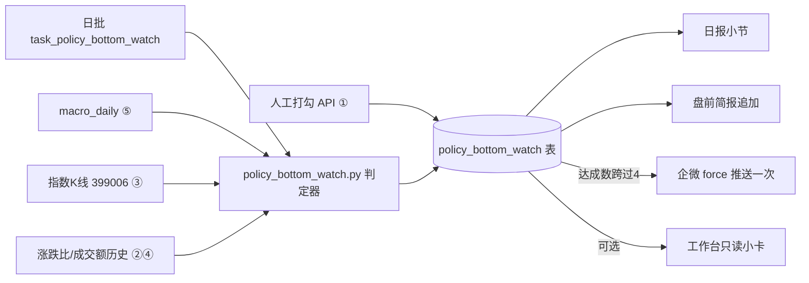

## 用户需求
基于用户提供的市场研判（“政策底轮廓已立、市场底滞后 1~3 个月、确认信号未出现”），为评分系统增加一套**“政策底观察 / 市场底确认清单”**机制，形成下一个开发计划。

## 核心功能
1. **市场底确认清单（5 条，每交易日自动判定打勾）**：
   - ① 汇金/国新新公告（无结构化数据源 ⇒ **人工打勾** + 快讯关键词辅助提示）
   - ② 两市成交连续地量（<1.3 万亿级）
   - ③ 创业板指周线止跌
   - ④ 涨跌比连续 2 日 >0.8
   - ⑤ 10Y 美债回到 5% 下方 **或** 布伦特跌破 95 美元
2. **每日输出打勾进度**：日报小节 + 盘前简报追加；达成数跨过 **4/5** 当日企微推送一次（事件驱动）
3. **提示但不执行仓位规则**：4/5 未达成时输出“建议总仓位上限 30%”提示语（**不自动执行**）

## 明确排除（Phase 1）
- **试错仓（单笔风险 0.4% 介入银行/红利）不做** —— 与 2026-10-18 已拍板的“防御市禁入场、不开影子仓”直接冲突；若要做须以“清单达成日的前瞻收益”为对象**另行预登记**并重新拍板（Phase 2）
- **不改 regime 四态**（C1 判据未冻结）⇒ 本机制是**独立观察标签**，不挂进 `market_regime.py`，不影响评分/排序/闸门/准入任何决策链
- 本观察器**不产生买卖信号**（预登记声明写在模块头）

## 视觉效果（可选 Phase 1b）
工作台“看盘序”附近一张只读小卡：五条清单逐行打勾/未勾 + 达成数（如 2/5）+ “距 4/5 还差 N 条”。


## Tech Stack
- 后端：Python + FastAPI（项目现有栈），复用日批任务模式（`scripts/daily_batch.py`）、企微推送（`flash/wechat.push_markdown_batched`）、双库兼容 DB 层
- 数据源（已实查）：⑤ `macro_daily`（us10y/brent 日度）✅；③ `_load_index_kline("399006")` 指数 K 线 ✅；④ 涨跌比实时有（快照 breadth）、**历史时序表待定位**；② 成交额实时有（`market_amount`）、**历史时序待定位**；① 人工 + `flash_news` 关键词辅助
- 前端（可选）：Vue3 现有工作台，只读卡片

## Implementation Approach
**纯观察器，零决策链**：新建独立模块，每日日批跑一次判定 → 幂等落库 → 双输出（日报/盘前简报）→ 仅在“达成数跨过 4”当日 force 推一次企微。与 regime、评分、闸门、模拟盘**完全解耦**，删掉本模块系统照常运行。

关键决策与理由：
1. **不做成 regime 新状态**：C1（regime 框架检验）判据未冻结，此刻动 `market_regime.py` 会污染待检对象；独立标签让 C1 的检验样本保持干净。
2. **判定全部收在一个模块的纯函数里**（输入数据 → 输出 checklist dict），阈值用常量+env 可调，便于单测与后续 Phase 2 预登记时引用同一口径。
3. **②④历史口径是唯一不确定点**：实时数据都有，但“连续 N 日”判定需要历史时序；候选源为 `market_emotion_daily`（情绪温度计含成交额分项）、`zz_daily_snapshots` payload、`contradictions` evidence metrics。开发第一步先用子代理定位，**找不到就从上线日起积累**（诚实标注“历史不足 N 日，该条暂不打勾”），绝不现拉补数据。
4. **第①条用人工打勾**：公告类信息无可靠结构化源，快讯关键词（汇金/国新/增持）只做“提示可能命中”，**打勾权在人**（与 `output_feedback` 同一“极简 POST”风格）。
5. **事件驱动推送**：只在达成数从 <4 跨到 ≥4 的当日推一次（同日幂等），避免每日轮询式推送造成告警脱敏（项目既有教训）。

## Implementation Notes
- 落库幂等：`policy_bottom_watch(date PRIMARY KEY, ...)` upsert，参照 `market_snapshot`/`paper_positions` 补列模式（PG `ON CONFLICT` / SQLite `INSERT OR REPLACE` 双写）
- 人工打勾覆盖：日批重算**不覆盖**人工确认的第①条（`COALESCE` 保留）
- 性能：全部读既有表（macro_daily/指数K线/清单表自身），零外部请求、零新增爬虫；单次任务 <1s
- 推送分级：跨过 4/5 → `force=True`；平时只进日报/简报正文，不推
- 诚实披露：任一条数据不足时该条标 `insufficient` 而非 `false`（缺失 ≠ 不满足）

## Architecture Design

不动：`market_regime.py`、评分引擎、闸门、模拟盘准入。

## Directory Structure
```
project-root/
├── backend/app/policy_bottom_watch.py   # [NEW] 核心模块：五条判定纯函数 + ensure_table + 每日快照落库 + 读接口；模块头写预登记声明（不产生信号；Phase 2 须另行预登记）
├── backend/app/schema.sql               # [MODIFY] 新表 policy_bottom_watch(date PK, checklist_json, n_checked, n_total, crossed_4, created_at)
├── backend/app/routers/market.py        # [MODIFY] 极简端点：POST /api/market/policy-bottom/confirm（第①条人工打勾/取消）+ GET 当日清单
├── scripts/daily_batch.py               # [MODIFY] 新增 task_policy_bottom_watch（排在 trader_brief 之前；幂等）
├── backend/app/daily_report.py          # [MODIFY] 新增小节：五条打勾进度 + “4/5 未达成 ⇒ 建议仓位上限 30%（提示，不自动执行）”
├── backend/app/trader_brief.py          # [MODIFY] 盘前简报“该做/该防”段追加清单进度一行
├── backend/test_policy_bottom_watch.py  # [NEW] 五条判定各造合成数据的边界单测（含数据不足=insufficient 分支）
├── frontend/src/views/Workbench.vue     # [MODIFY][可选 Phase 1b] 看盘序旁只读小卡
├── PLAN_NEXT.md                         # [MODIFY] 登记 C7：Phase 1 观察器（本计划）；Phase 2 试错仓明确排除并注明前置条件
└── backend/backtest_reports/            # [NEW] 历史回放披露报告（2024-09-24 / 2025-04-08 两段，描述性，不作判据）
```

## Key Code Structures
```python
# policy_bottom_watch.checklist_snapshot() 返回的 checklist_json 结构（判定与展示共用）
{
  "date": "2026-10-20",
  "items": {
    "nation_team_ann":  {"checked": true,  "source": "manual",  "note": "人工确认 10-19 公告", "ts": "..."},
    "amount_dry_up":    {"checked": false, "source": "auto",    "value": 1.42, "unit": "万亿", "window": "3日均", "insufficient": false},
    "chinext_weekly":   {"checked": true,  "source": "auto",    "detail": "本周收 2187 vs 上周 2130，首次转涨"},
    "breadth_ratio_2d": {"checked": false, "source": "auto",    "values": [0.61, 0.72], "insufficient": false},
    "us10y_or_oil":     {"checked": true,  "source": "auto",    "detail": "10Y 4.87% < 5%（brent 97.2）"}
  },
  "n_checked": 2, "n_total": 5,
  "crossed_4": false,          # 今日达成数首次 >= 4（推送闸）
  "position_hint": "4/5 未达成 ⇒ 建议总仓位上限 30%（提示，不自动执行）"
}
```
阈值常量（env 可调）：`PBW_AMOUNT_YI=13000`（亿）、`PBW_AMOUNT_DAYS=3`、`PBW_RATIO=0.8`、`PBW_RATIO_DAYS=2`、`PBW_US10Y=5.0`、`PBW_BRENT=95.0`。


## Agent Extensions
### SubAgent
- **code-explorer**
  - Purpose：定位“涨跌比”与“两市成交额”的**历史时序表**（候选 `market_emotion_daily` / `zz_daily_snapshots.payload` / `contradictions.evidence_json`），确认 ②④ 两条判定的历史数据口径与起始日期
  - Expected outcome：给出可用历史表名、字段、覆盖起始日与读取 SQL 样例；确认无历史源时明确“从上线日起积累”的结论，避免实现时再猜
