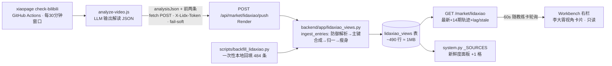

## 一、用户需求

`D:\stock-scoring\xiaopage` 项目轮询李大霄的 B 站视频，喂给 LLM 生成结构化解读 JSON。
需求：**LLM 输出视频解读的时刻，由 xiaopage 主动请求本项目的一个接口**，通知并更新工作台的「李大霄视角」卡片内容——事件驱动，不做轮询拉取。

> 方向修正记录：初版计划是"日批每日从 GitHub raw 拉 videos.json"。用户澄清两点后改为推送架构：
> ① xiaopage 链路一直在跑（此前探索用的是 I:\xiaopage 旧克隆，最新解读实为 2026-10-24 21:02）；
> ② 要求"LLM 输出解读的时刻"实时通知，而非日批粒度。这与项目 2026-09-26 的既有决策同源——
> `/system/batch-done` 注释自陈："用户明确要求**事件驱动**……② 后端轮询 → 用户否决'而不是轮询的方式'"。

## 二、现状与数据源（★ 实查 2026-10-25，fresh 数据全部已核实）

### xiaopage 产出链路（活跃）
- B 站用户空间 UID `2137589551`（李大霄）最新 5 条（≤900s）→ B 站 AI 字幕回退 faster-whisper 转写
  → SenseNova `deepseek-v4-flash` 结构化解读 → unshift 进 `public/data/videos.json`（GitHub Actions commit 回仓库）。
- **fresh 实况**（`D:\stock-scoring\xiaopage\public\data\videos.json`）：484 条 / 6.39MB；
  最新 `lishaoxiao_20261024 21:02`（score 40《平衡引资和融资》），近 5 条 10-22~10-24，**日更 1~3 条**。
- 推送时机可用性：LLM 输出发生在 Actions runner 内、`processSingleVideo()` 拿到 `analysisJson` 之后、
  Actions 末尾才 commit 回 GitHub ⇒ **"通知后回拉 raw"拿到的必是旧数据** ⇒ 回调必须**直接携带解读内容**。

### 解读 JSON 字段（卡片消费口径）
| 字段 | 类型/枚举 | 用途 |
|---|---|---|
| `_id` | `lishaoxiao_YYYYMMDD HH:MM` | 主键首选（⚠️ 18 条缺 `_id`，含 2026-09-24 的近期条 ⇒ 需主键合成兜底） |
| `bvid` / `title` / `date` | BV号 / 标题 / 北京时间 `YYYY-MM-DD HH:MM` | 卡片头 + 链接 + 排序（date 是硬性必填） |
| `sentiment_score` | 0-100，50=中性，越高越乐观 | 情绪倾向主指标 |
| `disclaimer_level` | 1-5（5=最强话术防御） | 展示"话术防御度" |
| `summary` / `tags` | ≤200 字 / ≤8 个 | 摘要 + 标签 |
| `structured.core_views` | string[] | 核心观点（含具体数字） |
| `structured.sectors` | string[] | 行业板块（银行/红利/高股息…） |
| `structured.operation_advice` | string | **弦外之音**（操作策略+多空态度；入库备用，卡面不展示） |
| `structured.risk_tips` | string[] | 风险警示 |
| `logic_factors[]` | `{factor_name, factor_value, weight 0-1, direction, description}` | 多空因子拆解（他常多空因子并存） |
| `hit_status` | pending/hit/miss | 观点命中跟踪（Phase 1 只入库，卡片不展示） |
| `deep_analysis.final_conclusion` | ≤300 字 | **卡面主文案**（deep_analysis 唯一入库字段；strategy/hidden_meanings/… 其余仍不入库） |

### 两处口径坑（★ 消费侧必须处理，均有实测证据）
1. **direction 枚举漂移（全量普查 33 种取值）**：主体是 看跌×1587 / 中性偏空×446 / 中性偏多×348 /
   看涨×214 / 中性×181，但散布 28 种变体：`看跌（对美股）`、`看多`（×2，不带"涨"字！）、
   `看涨/看跌（分化）`、`看跌（对高估股）/看涨（对防御股）`、`中性偏多（短期）`…
   ⇒ 不能 == 比较，必须包含式模糊归一（归一函数见 §十一，已按 33 种取值逐一验证规则覆盖）。
2. **情绪六级口径**（移植自 xiaopage `src/utils/sentiment.ts`，保证两站同分同色）：
   0-15 极度恐慌 / 16-35 悲观 / 36-45 谨慎偏空 / 46-55 谨慎偏多 / 56-75 乐观 / 76-100 极度狂热。
3. 视频链接**不在 JSON 里** ⇒ 由 bvid 拼 `https://www.bilibili.com/video/<bvid>`（无 bvid 时隐藏链接）。

### 本项目可复用的既有模式（推送架构的四个先例）
| 先例 | 位置 | 复用点 |
|---|---|---|
| **batch-done 事件回调** | `routers/system.py:110` | 无 JWT + 共享密钥 Header + 403 不区分未配置/错 token + 注释自陈"事件驱动"决策史 |
| **本地一次性回填** | `scripts/backfill_eq_anchor.py`（memory §148） | 历史数据本地灌 PG，不占 Actions/Render |
| **Workbench 轮询基建** | `Workbench.vue:4760+` `timers.push(setInterval(...))` | 教练卡 60s 无条件挂、workbench_scan 300s ⇒ 卡片挂 300s 同款 |
| **观察器模块骨架** | `key_level_watch.py` | ensure_table + db.upsert(conflict_columns) + 模块头预登记声明 |

## 三、核心功能（Phase 1）

1. **推送端点 `POST /api/market/lidaxiao/push`**（xiaopage LLM 输出解读的时刻调用）：
   共享密钥鉴权（`LIDX_PUSH_TOKEN`）；payload = `{entries: [新解读, 前一条, 再前一条]}`（**带前两条自愈**
   ——偶发推送失败时，下一条视频的推送会顺带补上）；逐条防御校验（缺 date 跳过该条不炸整请求），
   归一化后按 entry_id 幂等 upsert；返回 `{ok, stored, skipped, latest}` 供 xiaopage 日志留痕。
2. **读取端点 `GET /api/market/lidaxiao`**：最新一期全字段 + 近 14 期 `{date, score, title}` 轨迹 +
   `lag_days`（北京自然日差，常显）+ `stale`（>14 天）+ 免责 note。
3. **只读卡片（工作台右栏，「市场底确认清单」上方；卡面内容按用户 2026-10-25 线框拍板）**：
   标题 / 日期 / B 站链接 / 情绪分+等级（配色沿用 `dirColor` 多红空蓝青）+ 防御话术 n/5 /
   **一行主文案 `final_conclusion`** / 板块 tags / 近 14 期纯 CSS 情绪迷你条；
   60s 随教练卡同一定时器轮询自刷（用户拍板；响应 ~3KB，页面开一整天也不构成 egress 负担）。
   （summary/弦外之音/核心观点/因子**照常入库但不上卡面**，Phase 2 日报或折叠区直接取用。）
4. **一次性历史回填** `scripts/backfill_lidaxiao.py`：本地读 fresh 文件灌 PG（~484 条），
   卡片的"近 14 期轨迹"从第一天起就是完整的。
5. **新鲜度面板登记**：`system.py::_SOURCES` 加「李大霄解读」一格——push 断流/上游停更时首页一眼可见。

## 四、明确排除（Phase 1）

- **不做日批轮询拉取**（GitHub raw 全量拉）——改为事件推送；漏数据的兜底靠"payload 带前两条"自愈，
  更大缺口的历史对账 reconcile 任务放 Phase 2 可选项；
- **不进任何决策链**：评分/排序/闸门/准入/模拟盘/regime 零改动 —— R2：未检验的外部观点只能以"事实/参考"形态展示；
- **不做观点预测力验证**（"情绪分 vs 次日指数"是信号级命题，须另行预登记，见 §十四）；
- **不做企微重复推送**：xiaopage 自己已推企微解读，本项目再推 = 同一内容双份噪音（项目有"告警脱敏"教训）；
- 不做多 UP 主聚合、不做 SSE/WebSocket、**零新增 LLM 出网**（解读在 xiaopage 侧完成）。

## 五、视觉效果（工作台右栏，只读；★ 2026-10-25 用户线框定稿）

```
┌─ 李大霄视角 · 外部观点参考 ────────────── 数据截至 10-24 · 落后1天 ──┐
│ 平衡引资和融资                  2026-10-24 21:02 · BV1NgHK6jEga ↗   │
│ 情绪 40 · 谨慎偏空 · 防御话术 n/5                                     │
│ ▸ final_conclusion（≤300 字，折行显示）                               │
│ 板块: [银行] [红利] [高股息]                                          │
│ 近14期情绪: ▁▃▅▆▅▆▇▆…（纯 CSS 迷你条，高度=score，色=等级色）       │
└─────────────────────────────────────────────────────────────────────┘
```

- 比初版删掉：summary / 核心观点列表 / 弦外之音 / 逻辑因子 / 卡底免责行（均按用户线框，字段照常入库备用）；
- 免责文案不占卡面：`note` 保留在 API 响应里，全站免责已有 README §六 承接（要加回一行随时可以）。

## 六、Tech Stack

- 本仓库收端：Python FastAPI（`market` 路由 + `Body(default={})` + `Header` 鉴权，参照 batch-done）+
  `db.upsert(..., conflict_columns=["entry_id"])` PG/SQLite 双写兼容；
- xiaopage 推端：Node 18 全局 `fetch`（Actions runner 原生支持），fail-soft；
- 前端：Vue3 `Workbench.vue` 内联卡片 + 既有 `timers.push(setInterval)` 轮询基建。

## 七、Implementation Approach（关键决策与理由）

1. **推送携带内容，而非"通知后回拉"**：LLM 输出时刻 GitHub raw 尚未 commit（Actions 末尾才 commit），
   回拉必拿旧数据；且单条解读 ~15KB，直接进 body 比回拉 6.4MB 文件省两个数量级。
2. **payload 带前两条（共 3 条）**：runner 手里本来就有全量数组（`data.slice(0,2)` 零成本）；
   推送偶发失败（网络抖动/Render 重启）由**下一条视频的推送自动补齐**，免掉日批对账任务。
3. **鉴权复刻 batch-done**：共享密钥 env 各配一次；`not _LIDX_TOKEN or token != _LIDX_TOKEN ⇒ 403`
   （不区分"未配置"与"错 token"，防探测）；HTTPS 下足够，与既有安全水位一致。
4. **主键合成 `_id ‖ bvid ‖ date+title`**：18 条缺 `_id`（含 2026-09-24 近期条）证明 schema 会漂；
   缺 `date` 才跳过（排序/lag 的硬依赖），缺 bvid 只影响链接显示不影响入库。
5. **归一在入库时做**（情绪六级 + direction_norm 双存原文），展示层与 GET 消费方零猜测；
   归一函数是纯函数，用全量 33 种真实取值写单测。
6. **卡片刷新 = 60s 并入教练卡轮询**（用户 2026-10-25 拍板"跟教练一起轮训"）：接口只读
   小表前 15 行（~3KB/次），页面开一整天 ~4MB/天，远低于 167MB/天 egress 预算；
   不为低频事件引入 SSE/WebSocket 新基建（教练卡 60s 无条件挂是现成先例）。
7. **历史靠一次性本地回填**（backfill_eq_anchor 先例）：线上推送只管增量，484 条历史本地灌库，
   Actions/Render 零负担；回填与推送共用 `ingest_entries()`，口径天然一致。
8. **stale 阈值 14 天**：他不是每日发视频，滞后 2~7 天是常态；>14 天黄条措辞写"上游可能停更或推送异常"，
   不武断归因（面板 cadence 标"随B站视频推送（不定期）"）。
9. **两仓库部署顺序固定**：① Render 配 `LIDX_PUSH_TOKEN` + 部署端点 → ② 本地回填 → ③ xiaopage 合推送钩子。
   颠倒则推送 404/403（xiaopage fail-soft 只 warn，不炸主流程，但数据丢到下一条视频才补）。

## 八、Implementation Notes

- 表 DDL / 归一函数 / 端点伪码见 §十一；`ensure_table()` 模块级 `_READY` 守卫，参照 `key_level_watch.py:65`。
- **幂等**：entry_id 主键 upsert（hit_status 等字段后续推送覆盖更新）；xiaopage 重跑同视频重复推 = 覆盖不重复。
- **防御解析**：全部 `.get()` + 类型校验；坏条目逐条 skip 并计入响应 `skipped`（xiaopage 日志可见），不炸整请求。
- 端点日志遵循 ASCII 铁律⑥ 注释约定（`print(f"[lidaxiao] push stored={n}")` 风格）。
- **无日批任务**（Phase 1）：事件驱动架构 ⇒ TASKS/DEFAULT_ORDER/ALLOWED_TASKS 三处登记不适用；
  Phase 2 若加 reconcile 兜底任务再走三处。
- `lag_days` 按北京自然日差（`date` 字段即北京时间）；trend 取最新 14 条的 `{date 截日, score, title}`。
- 前端加载失败**静默保留上次值**（铁律 11，与市场底清单卡同款），不阻塞工作台首屏。
- Render env 新增：`LIDX_PUSH_TOKEN`（随机长串）；xiaopage GitHub secrets 新增：`SCORING_PUSH_URL`
  （= `https://<render>/api/market/lidaxiao/push`）、`SCORING_PUSH_TOKEN`（同值）。
- `render.yaml` 是清单不自动生效（memory §b9a0153d 教训）⇒ token 需在 Render 控制台手配，并在计划验收时口头确认。

## 九、Architecture Design


不动：评分引擎、闸门、regime、模拟盘、日批任务表、任何 LLM 调用。

## 十、Directory Structure（两个仓库）

```
stock-scoring-v2/                                  # ① 收端（本仓库）
├── backend/app/lidaxiao_views.py                  # [NEW] ingest_entries + ensure_table + load；模块头预登记声明
├── backend/app/routers/market.py                  # [MODIFY] POST /lidaxiao/push + GET /lidaxiao（policy-bottom 端点之后）
├── backend/app/routers/system.py                  # [MODIFY] _SOURCES + ("李大霄解读", "SELECT MAX(date) AS v FROM lidaxiao_views", "随B站视频推送（不定期）", 15)
├── scripts/backfill_lidaxiao.py                   # [NEW] 一次性回填（--file 默认 D:\stock-scoring\xiaopage\public\data\videos.json）
├── frontend/src/api/index.js                      # [MODIFY] getLidaxiaoView()
├── frontend/src/views/Workbench.vue               # [MODIFY] 右栏只读卡片 + loadLidaxiao() + 300s interval
├── backend/tests/generated/test_lidaxiao_views.py # [NEW] 归一/主键合成/端点鉴权与幂等单测
└── README.md                                      # [MODIFY] §六免责补"外部大 V 观点卡为 LLM 二手解读"

xiaopage/                                          # ② 推端（D:\stock-scoring\xiaopage，另一仓库）
├── scripts/analyze-video.js                       # [MODIFY] processSingleVideo 内 LLM 输出后调 notifyScoring()；fail-soft
├── .env.example                                   # [MODIFY] + SCORING_PUSH_URL / SCORING_PUSH_TOKEN
└── AUTOMATION.md                                  # [MODIFY] 登记推送钩子与 secrets

部署配置（非文件）
├── Render env: LIDX_PUSH_TOKEN                    # 随机长串（控制台手配）
└── xiaopage GitHub secrets: SCORING_PUSH_URL / SCORING_PUSH_TOKEN
```

## 十一、Key Code Structures

```sql
CREATE TABLE IF NOT EXISTS lidaxiao_views (
    entry_id TEXT PRIMARY KEY,          -- _id ‖ bvid ‖ "auto:"+date+"|"+title[:32]
    bvid TEXT, title TEXT, date TEXT,   -- date = 北京时间 "YYYY-MM-DD HH:MM"（必填，否则跳过）
    sentiment_score INTEGER, sentiment_level TEXT,   -- 六级标签，入库时算好
    disclaimer_level INTEGER,
    summary TEXT, tags TEXT,            -- tags/core_views/sectors/risk_tips 存 JSON 数组字符串
    core_views TEXT, sectors TEXT, operation_advice TEXT, risk_tips TEXT,  -- 入库备用（卡面不展示，Phase 2 日报/折叠区可用）
    final_conclusion TEXT,              -- deep_analysis.final_conclusion（卡面主文案；deep_analysis 其余字段不入库）
    factors_json TEXT,                  -- Top3 by weight: [{factor_name, weight, direction, direction_norm}]（入库备用）
    hit_status TEXT, created_at TEXT
)
```

```python
# ── 归一（纯函数，单测用全量 33 种真实 direction 取值逐一验证）──────────────
def sentiment_level(score) -> Optional[str]:     # 口径移植自 xiaopage src/utils/sentiment.ts
    if score is None: return None
    s = int(score)
    return ("极度恐慌" if s <= 15 else "悲观" if s <= 35 else "谨慎偏空" if s <= 45
            else "谨慎偏多" if s <= 55 else "乐观" if s <= 75 else "极度狂热")

def norm_direction(raw: str) -> str:             # 普查实证：看跌×1587/中性偏空×446/…/看多×2/变体28种
    d = (raw or "").strip()
    if not d: return "neutral"
    bull = any(k in d for k in ("看涨", "看多"))
    bear = any(k in d for k in ("看跌", "看空"))
    if (bull and bear) or "分化" in d: return "mixed"       # "看跌（对高估股）/看涨（对防御股）"
    if bear: return "bear"                                   # "看跌（对美股）" → bear
    if bull: return "bull"                                   # "看多" → bull（不带"涨"字的变体）
    if d.startswith("中性偏空"): return "bear"
    if d.startswith("中性偏多"): return "bull"
    return "neutral"                                         # "中性"/"中性偏多（短期）"→…偏多已命中
```

```python
# ── 端点（market.py，鉴权复刻 system.py::batch_done）───────────────────────
_LIDX_TOKEN = os.environ.get("LIDX_PUSH_TOKEN", "")

@router.post("/lidaxiao/push")
def lidaxiao_push(payload: dict = Body(default={}), x_lidx_token: str = Header(default="")):
    """xiaopage LLM 解读产出时刻的实时回调（事件驱动，参照 /system/batch-done 模式）。"""
    if not _LIDX_TOKEN or x_lidx_token != _LIDX_TOKEN:       # 不区分未配置/错 token，防探测
        raise HTTPException(status_code=403, detail="invalid token")
    entries = (payload or {}).get("entries")
    if not isinstance(entries, list) or not entries:
        return {"ok": False, "error": "entries required"}
    r = lidaxiao_views.ingest_entries(entries)               # 逐条防御校验，坏条目 skip 不炸
    return {"ok": True, **r}                                 # {stored, skipped, latest}
```

```js
// ── xiaopage 推端（scripts/analyze-video.js，Node18 全局 fetch）───────────
async function notifyScoring(entries) {          // entries = [analysisJson, ...data.slice(0, 2)]
  const url = process.env.SCORING_PUSH_URL;      // 未配置 = 静默关闭（本地开发不受影响）
  if (!url) return;
  try {
    const res = await fetch(url, {
      method: 'POST',
      headers: { 'Content-Type': 'application/json',
                 'X-Lidx-Token': process.env.SCORING_PUSH_TOKEN || '' },
      body: JSON.stringify({ entries }),
    });
    console.log('[scoring-push]', res.status, (await res.text()).slice(0, 200));
  } catch (e) {
    console.warn('[scoring-push] failed:', e.message);        // fail-soft：绝不阻断主流程
  }
}
// 挂点：processSingleVideo() 内 analysisJson 拿到后（写文件前后皆可）：
//   await notifyScoring([analysisJson, ...(data || []).slice(0, 2)]);
```

```jsonc
// GET /market/lidaxiao 响应（前端卡片唯一数据源）
{
  "ok": true,
  "latest": {
    "entry_id": "lishaoxiao_20261024 21:02", "bvid": "BV1NgHK6jEga",
    "title": "平衡引资和融资", "date": "2026-10-24 21:02",
    "video_url": "https://www.bilibili.com/video/BV1NgHK6jEga",
    "sentiment_score": 40, "sentiment_level": "谨慎偏空", "disclaimer_level": 4,
    "summary": "…", "tags": ["李大霄", "A股"],
    "final_conclusion": "李大霄用「平衡引资和融资」定调：…（≤300 字，卡面主文案）",
    "sectors": ["银行", "红利"],
    // ↓ 以下字段卡面不渲染（入库备用，Phase 2 日报/折叠区直接取）
    "core_views": ["…"], "operation_advice": "弦外之音：…", "risk_tips": ["…"],
    "factors": [{"factor_name": "…", "weight": 0.9,
                 "direction": "中性偏空", "direction_norm": "bear"}],
    "hit_status": "pending"
  },
  "trend": [{"date": "2026-10-24", "score": 40, "title": "平衡引资和融资"}],  // 近14期，新→旧
  "lag_days": 1, "stale": false,
  "note": "LLM 结构化解读（xiaopage 项目产物，非本人原文）；观点仅供参考，不构成投资建议，不进入本项目任何决策链"
}
```

## 十二、风险与处置

| # | 风险 | 处置 |
|---|---|---|
| 1 | Render 不可达/重启窗口丢推送 | xiaopage fail-soft 只 warn；payload 带前两条 ⇒ 下一条视频自愈；面板 lag_days 显性化 |
| 2 | 上游 schema 漂移（18 条缺 `_id` 是实证） | 逐条防御校验 + 主键合成兜底 + skipped 计数进响应/日志 |
| 3 | 推送端点被恶意刷（token 泄露） | 与 batch-done 同水位（共享密钥+HTTPS）；落库幂等 ⇒ 重放无害；必要时 Phase 2 加 Render 侧简单频控 |
| 4 | 二手解读失真 | 卡片常驻"LLM 结构化解读，非本人原文"；`operation_advice` 本质是 LLM 推测，文案如实 |
| 5 | 两仓库部署顺序颠倒 | §七-9 固定顺序；xiaopage 侧 fail-soft 保证颠倒了也只是丢一条（下条自愈） |
| 6 | 他连日不发视频 | lag_days 常显 + stale>14 天才警示，措辞两可（停更/推送异常），面板 cadence 标"不定期" |

## 十三、验收清单

- [ ] `pytest backend/tests/generated`：direction 33 种真实取值归一全对（重点：`看多→bull`、`看跌（对高估股）/看涨（对防御股）→mixed`）；缺 `_id` 条目主键合成为 `bvid` 或 `auto:` 前缀；`sentiment_level(40)="谨慎偏空"`；
- [ ] 端点单测：无 token / 错 token → 403；`entries` 非列表 → ok=false；混入 1 条缺 date 的坏条目 → 其余入库、`skipped=1`；同 entries 重推 → 行数不变（幂等）；
- [ ] 本地回填：`python scripts/backfill_lidaxiao.py` 灌入 ~484 条（缺 date 条目按日志 skip 计数），`SELECT MAX(date)` = `2026-10-24 21:02`；
- [ ] `GET /market/lidaxiao`：latest = 《平衡引资和融资》score 40 谨慎偏空，trend 14 期，lag_days=当日差；
- [ ] curl 模拟 xiaopage：POST 3 条（新+前2）→ `stored=3`；重推同 3 条 → `stored=3, 行数不变`；
- [ ] 工作台卡片渲染完整（final_conclusion 主文案、板块 tags、14 期迷你条、B 站链接、数据截至+落后天数），60s 随教练卡自刷；`npm run build` 过（11.2s ✓）；
- [ ] 首页新鲜度面板出现「李大霄解读」格（最新 10-24）；
- [ ] xiaopage 侧合钩子后实跑一次（手动 dispatch 或等下一视频）：后端日志见 push、表新增当日行；
- [ ] README §六免责补一句；`.codebuddy/memory` 记录；Render 控制台确认 `LIDX_PUSH_TOKEN` 已配。

## 十四、Phase 2 备选（本期不做，防止范围蔓延）

- **日批 reconcile 兜底任务**（拉 GitHub raw 对账补漏，走三处登记）——"前两条自愈"已覆盖常见故障，仅在实测漏数据 >2 条时再上；
- 日报/盘前简报引用"李大霄最新观点"小节（读同一张表，零新数据源）；
- **观点预测力观察**（sentiment_score vs 次日/5日指数涨跌命中率）——信号级命题，须判据先冻结 + 预登记 + `edge_verify` 月度复核通道，不与本期混做；
- `hit_status` 命中率展示（依赖 xiaopage 侧回填机制）；
- 多 UP 主聚合（依赖 xiaopage 文本链路 JSON 化）。
