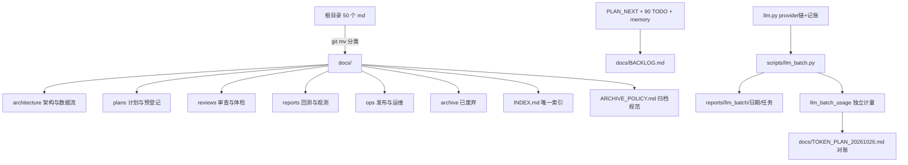

## 需求概述
为项目制定「全项目清理优化 + 文档归档」完整方案，并覆盖六项交付：文档归档、开发注意事项、未完成盘点、大额 token 使用规划（10/26 前 5 亿，glm5.3 / glm5.3-flash）、清理 vs Skills 取舍、分阶段执行计划。

## 已确认口径
- **token 额度为真实可执行**：允许真实调用产生消耗，但必须带安全阀（每日/每任务上限、可中断、可对账）。
- **文档做实体归档**：新建 `docs/` 并用 `git mv` 搬迁根目录约 50 个 md，按类型分入二级目录；根目录仅保留入口文档。
- **责任人按模块分派**：后端 / 前端 / 数据流水线 / 文档 四类（实际单执行人，便于按域推进）。
- 时间窗：当前 2026-10-24（周六），目标 2026-10-26（周一）23:59 前，仅 D0/D1/D2 三天。

## 核心交付内容
1. **文档目录与归档规范**：`docs/{architecture,plans,reviews,reports,ops,archive}` 六分法 + `docs/INDEX.md`（每份一句话定位、状态、最后更新）+ `docs/ARCHIVE_POLICY.md`（保留/更新/废弃三分法、命名 `YYYYMMDD_主题.md`、删除前置条件）。
2. **开发注意事项清单**：`docs/DEV_CHECKLIST.md`，含环境变量、依赖与版本、数据源与限额、发布/回滚、验证纪律（构建通过≠交互可用）、常见坑 Top-N、以及"前端改动禁止本地 publish"等硬纪律。
3. **未完成内容盘点**：`docs/BACKLOG.md`，来源为 `PLAN_NEXT.md` 未勾选、全仓约 90 处 TODO/FIXME/待补标记、`.codebuddy/memory` 中的遗留问题；字段含模块、优先级 P0/P1/P2、阻塞关系、预估工时、验收口径。
4. **5 亿 token 分配策略**：按任务类型给出比例、批次与每日进度（代码审查约 40%、测试生成约 25%、文档生成约 20%、重构建议约 15%，预留 10% 缓冲），并说明哪些任务适合批量消耗、哪些必须人来判断。
5. **清理 vs Skills 取舍结论**：给出对比表与明确建议（建议以「清理先行 + 3~5 个高频流程沉淀为 skill」的组合策略），并说明不做什么。
6. **执行计划**：D0/D1/D2 三天时间表，每阶段产出物、验收标准、回滚点与 token 对账口径。

## 视觉/呈现效果
不涉及界面改造。文档以 Markdown 呈现，统一标题层级、表格化字段（优先级/模块/责任人/验收），`docs/INDEX.md` 作为唯一入口索引，保证"任何一份文档都能被一句话定位并判断其是否仍有效"。


## 技术栈与约束
- 文档：纯 Markdown，位于 `docs/`（新建）；搬迁用 `git mv` 保留历史。
- 批处理脚本：Python 3（复用 `backend/app/flash/llm.py` 的 provider 链与 `_record_usage` 记账范式），CLI 形态 `scripts/llm_batch.py`。
- 数据库：复用 `app.database.db`（PostgreSQL/SQLite 双兼容写法），新增独立表 `llm_batch_usage`，**不与线上 `llm_usage_daily` 混账**，避免把业务日熔断打满导致盘中简报/复盘中断。
- 不做：不改业务逻辑、不动评分/闸门/模拟盘、不引入新外部依赖。

## 实施策略

### 1. 文档归档（D0）
- 建立 `docs/` 六目录；根目录白名单保留：`README.md`、`CONTEXT.md`、`DEPLOY.md`、`EGRESS.md`、`logs.md`（体量大且被引用，先留 + 在 INDEX 标注）。
- 搬迁规则：`PLAN_*` / `AUDIT_PLAN_*` → `docs/plans/`；`_report_*` / `*_结论_*` / 回测产物说明 → `docs/reports/`；`全项目审查_*` / `项目专业审视_*` / `专业度缺口_*` / `上线观测单_*` → `docs/reviews/`；`顶层框架与数据流_*` / `股票逻辑全景_*` / `交易日全流程.md` / `开发文档.md` / `Agent知识库_*` → `docs/architecture/`；`交易方法论落地计划_*` / `工作台开发需求_*` / `zzshare功能盘点_*` → `docs/plans/` 或 `docs/architecture/`（按"是否已实现"判定）。
- 已过期的旧版计划（如 `PLAN_ARCHIVE_2026-09-12.md`、被 `PLAN_NEXT.md` 取代的条目）移入 `docs/archive/`，**不删除**，由 `ARCHIVE_POLICY.md` 定义"可删条件 + 需用户确认"。
- 产出 `docs/INDEX.md`：表格列 = 文档路径 / 一句话定位 / 类型 / 状态（有效/待更新/已废弃）/ 最后更新 / 关联模块。

### 2. 开发注意事项（D0-D1）
`docs/DEV_CHECKLIST.md` 分六节：环境与密钥、依赖与版本、数据源与限额（腾讯/东财/zzshare/金十/Cookie）、发布与回滚（Actions 部署、`keep_files`、禁止本地 orphan publish）、验证纪律（构建通过≠交互可用、必须真调用一次）、时点与诚实口径、常见坑 Top-N（早产缓存、cluster 空字段、9.5% 口径、symlink latest、approximate 涨跌停等，逐条指向 MEMORY 记录）。

### 3. 未完成盘点（D1）
- 采集：`PLAN_NEXT.md` 未勾选项 + 全仓 TODO/FIXME/待补 + memory 遗留。
- 归一化字段：`ID / 模块 / 事项 / 类型(功能|缺陷|技术债|文档) / 优先级 / 阻塞 / 工时 / 验收 / 来源`。
- 优先级规则：P0 = 影响数据正确性或线上可用；P1 = 影响体验/可维护性；P2 = 优化与想法。

### 4. 5 亿 token 规划与运行器（D0 建器，D1-D2 执行）
- 运行器 `scripts/llm_batch.py`：
  - `--task review|tests|docs|refactor`、`--files`/`--glob`、`--max-calls`、`--max-tokens`、`--dry-run`、`--resume`；
  - 输入必须来自仓库文件清单（不自由发挥），输出 `reports/llm_batch/<date>/<task>/<slug>.md`；
  - 断点：每文件 `.done.json`（prompt hash + tokens），重跑跳过；`reports/llm_batch/STOP` 存在即停，Ctrl+C 优雅退出写断点；
  - 记账：写 `llm_batch_usage(day, task, calls, prompt_tokens, completion_tokens, cost_est)`，并在结束时打印本次/当日累计与剩余额度；
  - 质量抽检：每任务随机 5% 产出标记 `needs_review`，低于可用阈值即暂停该任务。
- 5 亿 = 500,000,000 tokens；按 3 天摊：D0 20%（1.0 亿，跑通+基线）、D1 45%（2.25 亿，主力批次）、D2 35%（1.75 亿，补漏+收尾），每日硬上限 2 亿，保留 10% 缓冲用于重跑。
- 适配性说明：代码审查/测试生成/文档生成/重构建议适合批量；架构取舍、交易逻辑变更、涉及资金/决策链的改动必须人工判断，不纳入批量。

### 5. 清理 vs Skills（D1）
- 对比维度：一次性收益、持续收益、维护成本、漂移风险、上手成本。
- 结论建议：**清理优先**（341 个 md / 90 处 TODO 持续污染上下文，收益确定）；同时把 3~5 个高频流程沉淀为 skill（新增观察器、LLM 接入范式、数据包发布与回滚、前端发版与强刷验证、新增日批任务）。
- 明确不做：不把业务判断（评分/闸门/交易纪律）写进 skill，避免"流程化"掩盖判断责任。

### 6. 执行计划（D2 汇总）
`docs/EXECUTION_PLAN.md`：D0/D1/D2 三段时间表（上午/下午/晚间三段）、每阶段产出物、验收标准（可核对：文件是否存在、INDEX 是否覆盖、BACKLOG 条目数、token 对账表是否闭合）、回滚点（`git mv` 可整体 revert；脚本只读仓库、输出独立目录，无副作用）。

## 架构与目录结构



```
docs/
├── INDEX.md                          # [NEW] 人读索引：路径/一句话定位/类型/状态/更新时间/关联模块
├── ARCHIVE_POLICY.md                 # [NEW] 保留-更新-废弃三分法、命名规范、可删条件、搬迁记录
├── DEV_CHECKLIST.md                  # [NEW] 开发注意事项清单（env/依赖/数据源/发布/验证/坑）
├── BACKLOG.md                        # [NEW] 未完成盘点（模块/P/阻塞/工时/验收/来源）
├── TOKEN_PLAN_20261026.md            # [NEW] 5 亿分配、批次清单、安全阀、对账口径
├── CLEANUP_VS_SKILLS.md              # [NEW] 两方案对比与组合建议
├── EXECUTION_PLAN.md                 # [NEW] D0-D2 时间表/产出/验收/回滚
├── architecture/                     # [NEW] 搬迁：顶层框架与数据流、股票逻辑全景、交易日全流程、开发文档、Agent知识库
├── plans/                            # [NEW] 搬迁：PLAN_*、AUDIT_PLAN_*、交易方法论落地、工作台开发需求、zzshare 盘点
├── reviews/                          # [NEW] 搬迁：全项目审查、项目专业审视、专业度缺口、上线观测单、子指标 IC 体检
├── reports/                          # [NEW] 搬迁：_report_*、分状态回测结论、价格源扩容选型
├── ops/                              # [NEW] 搬迁：EGRESS、logs、部署相关补充（README/DEPLOY 留根目录做入口）
└── archive/                          # [NEW] 旧版计划与已被取代文档（不删，标注被谁取代）

scripts/
└── llm_batch.py                      # [NEW] 批量 LLM 运行器：任务类型/文件清单/预算上限/断点/记账/抽检

backend/app/
└── llm_batch_usage.py                # [NEW] 独立计量表与查询（与 llm_usage_daily 隔离）
```

## 关键接口（仅在必要时落地）

```python
# backend/app/llm_batch_usage.py
def record(task: str, prompt_tokens: int, completion_tokens: int,
           calls: int = 1, cost_est: float = 0.0) -> None: ...
def summary(day: str | None = None) -> dict:
    """返回 {day, total_tokens, by_task: {...}, budget_tokens, remaining_tokens}"""
```

## 实施注意
- `git mv` 后必须同步修正被引用路径（README/CONTEXT/代码注释中出现的旧文件名），否则索引与代码注释会指向不存在的文件；搬迁后用一次全仓 grep 校验。
- 批量脚本默认 `--dry-run`，真实执行需显式 `--execute`；所有调用 `toward_budget=False` 语义，绝不占用线上日熔断额度。
- 5 亿是上限而非目标：优先保证产出可用率（抽检通过率 ≥ 80%），不足时宁可少跑也不灌水；每日对账写回 `TOKEN_PLAN` 的执行记录表。
- 全程不改业务代码；`scripts/llm_batch.py` 与 `llm_batch_usage.py` 为新增文件，可整体删除回滚。


## Agent Extensions
### SubAgent
- **code-explorer**
  - Purpose: 盘点全仓未完成事项（`PLAN_NEXT.md` 未勾选项、约 90 处 TODO/FIXME、memory 遗留），并核实文档被引用关系（搬迁后需修正的路径）。
  - Expected outcome: 输出结构化清单（模块/事项/类型/优先级/来源行号），直接作为 `docs/BACKLOG.md` 的数据源；同时给出"搬迁后需同步修改的引用文件列表"。
### Skill
- **skill-creator**
  - Purpose: 将 3~5 个高频重复流程沉淀为可加载 skill（新增观察器、LLM 接入范式、数据包发布与回滚、前端发版与强刷验证、新增日批任务）。
  - Expected outcome: 生成可被后续会话直接加载的 skill 目录（含触发条件、步骤、检查项、常见坑），并在 `docs/CLEANUP_VS_SKILLS.md` 中登记清单与维护责任人。
