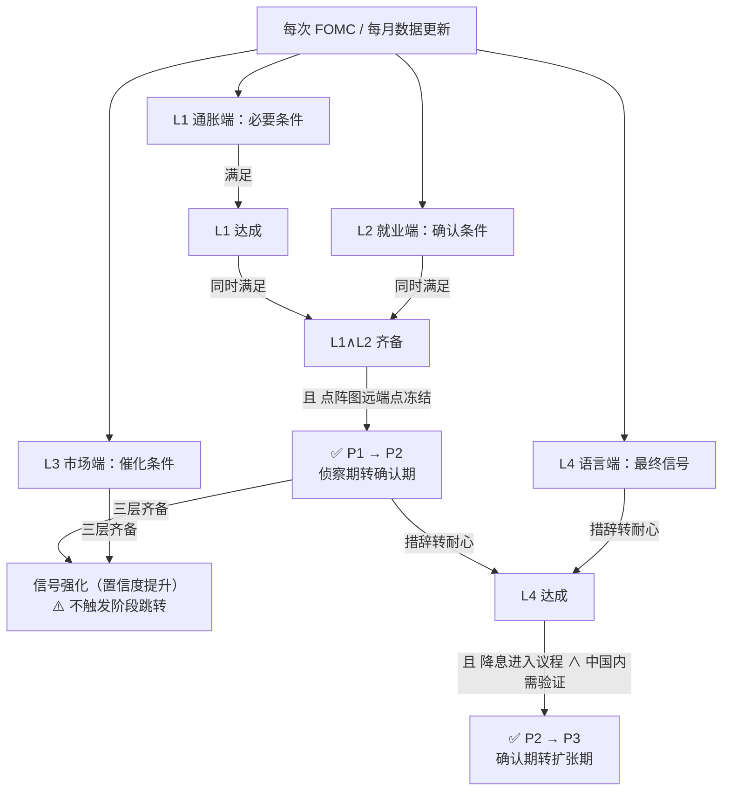
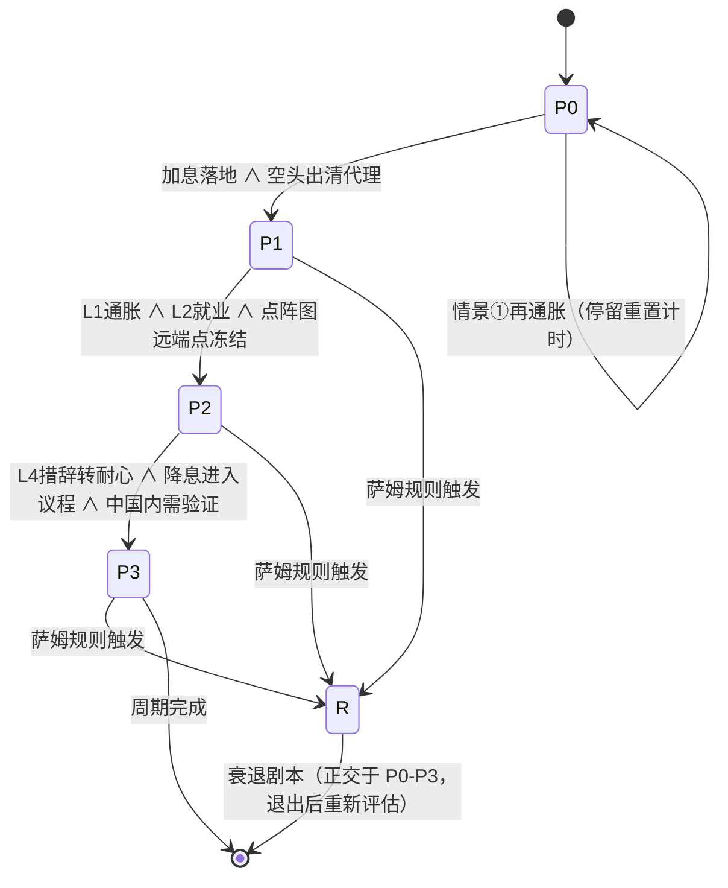

# 全球宏观周期判断与资产配置逻辑框架
**——供项目 Agent 逻辑调整与功能开发使用**
---
## 文档信息
| 项目 | 内容 |
| :--- | :--- |
| 文档版本 | **v1.1**（v1.0 原文 + 2026-11-08 审查修订） |
| 生成日期 | 2026-11-08 |
| 审查日期 | 2026-11-08（见 §〇 审查与修订、§十 与项目现有装置的关系） |
| 文档目的 | 汇总宏观分析框架、信号判断逻辑、阶段配置规则，供 Agent 实现状态机判断、信号生成与配置建议输出 |
| 核心前提 | ① 沃什任美联储主席；② 2026年12月加息为基准情景；③ 中国"政策底"已确认 |
| ⚠️ 性质声明 | 本文档为**情景推演框架**，非投资建议。所有阈值为"观察标尺"，需随数据动态校准。部分前提（如沃什立场、12月加息）基于推演而非实时验证数据，Agent 实现时应将其作为**可配置参数**而非硬编码事实 |
---
## 〇、审查与修订（2026-11-08，**接入项目前必读**）

本文入项目审查，结论：**框架骨架可取，但按原文直接实现会出三处硬伤、并撞两条项目红线。**
本节先说结论，正文已在对应位置就地修订（改动处均标 `★ 2026-11-08 修订`）。

### 0.1 前提的事实核对（用项目内真实数据）

| 文档前提 | 核实结果 | 证据（`flash_news`） |
|---|---|---|
| 沃什任美联储主席 | ✅ **成立** | 2026-11-06 22:19「白宫 NEC 主任哈塞特：（谈美联储）…我们将尊重**美联储主席沃什**与美联储的判断」 |
| 加息周期（非降息） | ✅ **成立** | 2026-10-31 01:42 达拉斯联储主席洛根：「至少还需**两次各 25bp、累计 50bp** 加息」 |
| 民主党赢中期选举 | ✅ **成立** | 2026-11-07 19:17「特朗普…挽回**中期选举失利**后的影响力」 |
| **"本轮是滞胀磨底"** | ⚠️ **项目数据不完全支持** | ① 2026-10-29 美国 Q3 GDP **3.4%**（高于 Q2 的 2.2%、高于预期 3.2%）⇒ "滞"不成立；② 项目 `macro_regime_class`（2026-11-06）分布 `soft 0.375 / stag **0.25** / rec 0.375 / overheat 0` ⇒ **滞胀只占 25%，不是主情景** |
| **"2026年12月加息为基准情景"** | ⚠️ **已被现实削弱，须重估** | **10 月 FOMC 已停止加息**：维持 3.75%–4%（**10 票赞成 / 2 票反对**，库克与哈玛克主张再加 25bp）；措辞从「今天的政策行动将有助于…」改为「**随着更多信息的积累，委员会将能够确定合适的政策立场**」⇒ 从"行动中"转向"观察中"。**若 12 月不加，本框架 P0→P1 的触发条件"加息落地"将永不成立** |
| 政策底已确认、市场底未到 | ✅ 方向一致 | `policy_bottom_watch` 2026-11-06 **2/6** 打勾（`chinext_weekly`、`us10y_or_oil`），市场底确认条件远未齐备 |

**★ 关于"12 月加息"要展开说（2026-11-08 补，来自 FOMC 声明对比）**：

框架把「12 月加息落地」设为 **P0→P1 的唯一触发条件**。但实际序列是：

```
2026-09 FOMC：加息 25bp → 3.75%–4%（12 票赞成 / 0 票反对，全票）
2026-10 FOMC：**维持不变**（10 票赞成 / 2 票反对，两票主张再加 25bp）
```

**两种读法都有道理，必须选一个**：

| 读法 | 依据 | 后果 |
|---|---|---|
| **9 月就是"最后一加"**（呼应框架"盯最后一加"的核心） | 10 月已停；措辞转向"数据评估" | 市场底区间 = 2026-09 ~ 2027-03，**现在已在区间内** |
| 12 月还会加（框架原文基准） | 洛根"还需两次 50bp"；10 月有 2 票主张继续加 | P0 延续到 12 月后 |

**⇒ 两条互斥，必须等 12 月 FOMC（约 12 月中）才能裁。**
在此之前，任何"阶段推进"都建立在一个**未定的前提**上 —— 这是本框架当前**最脆弱的环节**，
比"缺数据"更根本（数据可以补，前提错了整条链都要重写）。

**可观测的分水岭**：12 月加不加。
- **加** ⇒ 走框架原路径（P0 延续，2027 上半年确认底）
- **不加** ⇒ P0→P1 的触发条件失效，须改用"最后一次加息已过"的判定（回溯 9 月），
  相当于**起点整体前移一个季度**

**★ 完整利率序列（2026-11-08 从 FOMC 声明对比接口拉全，`14ee25dd`）**：

```
2025-07  维持 4.25%–4.5%
2025-09  下调25bp  至 4.00%–4.25%
2025-10  下调25bp  至 3.75%–4.00%     ← 连续降息 3 次
2025-12  下调25bp  至 3.50%–3.75%
2026-01  维持 3.50%–3.75%
2026-03  维持 3.50%–3.75%
2026-04  维持 3.50%–3.75%
2026-06  维持 3.50%–3.75%
2026-07  维持 3.50%–3.75%
2026-09  **上调25bp 至 3.75%–4.00%**   12:0 全票  ← 重启加息
2026-10  维持 3.75%–4.00%             10:2     ← 暂停，两票主张继续加
```

**这个序列说明三件事**：

1. **框架说的"加息周期"成立且更戏剧**——不是缓慢加息，而是
   「2025 年降了 3 次 → 停 7 个月 → **2026-09 全票重启加息**」。
   **12:0 全票加息**说明鹰派共识极强，这正是框架对沃什的判断（"以强硬鹰派自证独立"）。
2. **10 月的 2 票反对不是"转鸽"**——库克与哈玛克主张的是**继续加息 25bp**，
   即分歧方向是"更鹰 vs 更鹰"，不是"鹰 vs 鸽"。**这比框架原文的假设更鹰**。
3. **9 月是否是"最后一加"仍不确定**——因为有两票在 10 月主张继续加，
   12 月再加的概率不低。框架的"12 月加息"基准**没有被打脸，但也没被确认**。

**⇒ 对 P0→P1 的影响**：不能简单说"9 月是最后一加"或"12 月一定加"。
正确做法是**等 12 月 FOMC**，在此之前把 `hike_landed` 判为 `unknown` 而非 `False`。

**⇒ 最重要的一条**：本文属于**叙事判断**，而项目 `macro_regime_class` 是**证据函数**
（该模块文件头明写："分布必须是证据的函数，不是判断的函数"，并把 `llm.scenarios`
这类不可复算的概率定性为"只能当叙事"）。
**两者可以并存，但不得混用**：叙事可以解释"为什么可能这样"，不能替代分布去打勾。

### 0.2 三处硬伤（**不修就无法实现**）

| # | 问题 | 具体表现 |
|---|---|---|
| **H1** | **状态机有三套互不一致的转换条件** | §4.1 流程图：`L1+L2` = 阶段1→2，`+L3+L4` = 阶段2→3；§5.1 状态机：`P1→P2` = 点阵图冻结 + 措辞耐心，`P2→P3` = **降息启动 + 中国内需回暖**；§八 伪代码：`P2→P3` = `L4.PATIENT and L4.EASING_DISCUSSION`。**三套都不同**，Agent 无法照做（详见 §5.1 修订） |
| **H2** | **`P0→P1` 条件"空头出清"无可操作定义**，且伪代码里直接漏掉 | §5.1 写"12月加息落地 + **空头出清**"，但全文未定义什么叫空头出清；伪代码只有 `hike_landed()`。⇒ 建议改为可测代理（见 §5.1 修订） |
| **H3** | **仓位口径两层混写** | §5.2 表中"A股三角 60/30/10"（合计 100%）与"现金 15–20%"并列，但未说明 60/30/10 是**总资产**占比还是**A股内部**占比。两者口径完全不同，Agent 无法生成配置输出（详见 §5.2 修订） |

### 0.3 两条项目红线（**必须降级，否则不能进项目**）

| 文档内容 | 项目既有约束 | 处理 |
|---|---|---|
| §5.2 给出**具体仓位配比**（红利盾 60% / 价值底 30% / 成长矛 10%、现金 15–20%、美债久期 ≤2 年…） | `app/policy_bottom_watch.py` 预登记声明第 3 条：原始需求里"用试错仓介入防御主线"**本项目不做**，与 2026-10-18 已拍板"**不开影子仓、防御市禁入场**"直接冲突 | **配置权重表降级为"参考叙事"，不得作为仓位建议输出**；若要变成机器可执行，须先**另行预登记**（同 `PLAN_*_EDGE.md` 制度） |
| §八 的 M3 状态机"阶段推进" | 项目现有 `macro_regime_class`、`stagflation`、`policy_bottom_watch` **全部是观察器**，硬约束"不进评分/闸门/仓位/模拟盘" | 新状态机同样只能是**观察器**；且必须在文档里写清它与 `macro_regime_class` 的**上下位关系**（当前缺失） |

### 0.4 四处细节缺陷（P1，会实现错）

| # | 问题 | 修正 |
|---|---|---|
| D1 | **萨姆规则定义不精确**："3 个月均值较 12 个月低点上升 ≥0.5pp" —— "低点"指单月还是 3 月均值？ | 标准口径是**3 个月移动平均 相对"过去 12 个月内 3 月均值的最低值"**，已修正（§4.3） |
| D2 | **`priority` 语义未定义**，且与 `weight:"必要条件"` 冲突（布尔否决 vs 连续加权） | 已加 `_semantics` 字段说明（§4.2） |
| D3 | **情景概率加总仅 80%**，且 ①与②自称"互斥镜像"却又各给独立概率 | 已加"基准情景 20%"与互斥说明（§六） |
| D4 | **§2.2 内在矛盾**：称沃什"可能反向操作（更鹰）"，却给"12 月一加后 3.75–4.0%"的温和路径 | 已加注：该点阵图为**基准路径**，鹰派反向属 ①情景，二者不可同时作为基准（§2.2） |

### 0.5 数据底座：`macro_daily` 的日期格式陷阱（**接入 L3 层前必读**）

`macro_daily.date` **全表**存的是 `2026/9/7` 这种**斜杠且不补零**格式 ——
这**不是脏数据，是刻意的**：`flash/store.py` 的 `_bj_date()` 注释明写"与旧项目兼容：2026/8/15"。

后果：**字符串排序对日期失效**（`'9' > '1'`），且**全表 46 行都是这个格式**。

```
ORDER BY date DESC LIMIT 5  ⇒  2026/9/7, 2026/9/4, 2026/9/30, 2026/9/3, 2026/9/29
真实最新是 2026/11/6，却排不到前面
```

**现状（审查实测）**：项目内 5 处消费方**已各自手动解析绕过**：

| 消费方 | 处理方式 |
|---|---|
| `coach/rules.py:763` `_to_date()` | 兼容两种写法，注释标明"顺带修掉一个静默失效" |
| `thesis_tracker.py:169` | 自查注释："字符串排序会把 10 月排到 9 月前面" |
| `stagflation.py:137` | "必须解析成 datetime 排序" |
| `backtest/strategies.py:577` | 兼容斜杠不补零格式 |
| `flash/store.py` `load_macro_daily` | 按参数查单日，不涉排序 |

**⚠️ 但有 1 处漏网**：`mainforce/confluence.py:64`

```python
r = db_fetch_one("SELECT data_json FROM macro_daily ORDER BY date DESC LIMIT 1")
```

**没有解析、直接字符串排序 ⇒ 取到的是 9 月的宏观方向分**，而不是 11 月的。
该值进入 `_env_snapshot()` 的 `macro_score` / `macro_level`，影响合流判断。

> **⇒ 对本框架的意义**：§4.2 的 L3 层（30Y 美债 / 布伦特 / DXY）若从 `macro_daily` 取数，
> **必须自己解析日期排序**，不能依赖 `ORDER BY date DESC`。
> （注：`policy_bottom_watch` 第⑤条用的是 `auto:live` 实时源，未被影响。）
>
> **这独立于本文的取舍**：无论是否采纳本框架，`mainforce/confluence.py` 这处都值得修。
> 更彻底的做法是把 `_bj_date()` 改为 `YYYY-MM-DD` 并迁移 46 行 —— 但那会破坏"旧项目兼容"，
> 需评估其他读取方（如 `macro_daily_history` 的日期来源）后再定。

---

## 一、核心结论速览（TL;DR）
1. **当前所处位置**：中国"政策底"已确认（2025年10月前后），美国"利率顶"**尚未确认**。两者形成"剪刀差"，全球资本处于"先防御、后再配置"的再平衡前夜。
2. **市场底的判断标尺**：**不是第一次降息，而是"点阵图停止上移"**（即最后一次加息的确认）。
3. **形态判断**：本轮**不是2008年式的V型危机底**，而是"**滞胀磨底型**"（L型/W型），政策底→市场底→经济底的传导被美国加息周期**拖拽拉长**。
   > ★ 2026-11-08 修订：这是**叙事判断**，与项目数据有两处张力，实现时不要当作事实输入：
   > ① 2026-10-29 美国 Q3 GDP **3.4%** 超预期（Q2 为 2.2%）⇒ "滞"这一半不成立；
   > ② 项目 `macro_regime_class`（2026-11-06）分布 `soft .375 / stag .25 / rec .375 / overheat 0`
   > ⇒ **滞胀只占 25%，不是主情景**。
   > 建议表述改为："本框架假设滞胀磨底为主形态（**待证据支持**），若 `macro_regime_class`
   > 的 `stag` 连续 N 日低于 `soft`/`rec`，本框架的 P0 停留期假设需要重新评估。"
4. **三底时间序列（推演）**：
   - 政策底：2025年10月（已发生）
   - 市场底：2026年12月加息落地后 → 2027年上半年确认
   - 经济底：2027年下半年
5. **核心操作逻辑**：仪表盘三灯（核心PCE回落 + 失业率温和升至4.5-4.7% + 沃什措辞转"耐心"）全绿 = 市场底发令枪。此前用"三角防御组合"分批布局；此后将重心从"红利盾"切向"成长矛"。
---
## 二、背景与前提假设（Agent 需内置的上下文）
### 2.1 美国政治格局（2026中期选举后）
| 要素 | 状态 | 影响 |
| :--- | :--- | :--- |
| 选举结果 | 民主党夺回参众两院，"蓝潮" | 府会分治，立法僵局 |
| 败选归因 | 通胀（关税+伊朗战事推高生活成本）为首要因素；48%选民将生活成本列为首要议题 | 通胀是政治死穴，强化美联储鹰派立场 |
| 特朗普姿态 | 表面祝贺+实质强硬；自称"否决先生"；拒绝撤换防长赫格塞思；筹备"预防性赦免" | 政治对抗常态化，存在美联储独立性风险 |
| 关键突破州 | 得州（民主党参议员+州长）、密歇根（首位穆斯林参议员） | 共和党基本盘松动 |
### 2.2 美联储政策体制（沃什时代）
| 维度 | 沃什框架 | 与鲍威尔框架的区别 |
| :--- | :--- | :--- |
| 核心哲学 | 严格通胀目标制，对超调容忍度极低 | 鲍威尔允许阶段性超调 |
| 点阵图用法 | **主动战略工具**（管理预期、对抗政治压力） | 鲍威尔主要用于渐进沟通 |
| 加息倾向 | 预防性加息，无视供给冲击成因 | 鲍威尔对供给冲击倾向耐心等待 |
| 独立性策略 | 以强硬鹰派自证独立，可能"反向操作" | 鲍威尔试图维持表面中立 |
**点阵图基准预测（12月加息情景下）**：
- 2026年底利率：**3.75% - 4.0%**（含12月加息后可能还有1-2次）
- 2027年底：**3.5% - 3.75%**（宽松节奏极慢）
- 长期利率中枢：**2.75% - 3.0%**（显著上移）
- 点分布特征：极度集中、鹰派统一

> ★ 2026-11-08 修订（此表存在内在矛盾，实现时须二选一）：
> 本节上文说沃什"以强硬鹰派自证独立、**可能反向操作**"，但本表给的是
> "**只加 1 次**、2027 年即转缓"的温和路径。两者不能同时作为基准：
> **鹰派反向 = 情景①（再通胀）**，本表 = **基准情景**。
> ⇒ Agent 实现时应把"点阵图预测值"当作**可配置参数**（默认 3.75–4.0%），
>   并在每次 FOMC 后用真实点阵图覆盖它，而不是把它当已知事实。
> 佐证（项目 `flash_news`）：2026-10-31 洛根称"至少还需两次各 25bp、累计 50bp"，
>   **比本表更鹰** —— 说明"只加一次"的基准路径偏乐观。
### 2.3 中国政策环境（政策底已确认的证据链）
| 领域 | 关键政策 | 信号 |
| :--- | :--- | :--- |
| 战略锚 | "十五五"规划：夯实基础、全面发力的关键期 | 五年维度确定性 |
| 实体经济 | 制造业占GDP 25.7%，高技术制造业+14.3% | 压舱石地位 |
| 资本市场 | 长钱长投机制（公募3年以上考核权重≥80%）；回购增持再贷款利率降至1%；SFISF常态化扩围31家、申报超1000亿 | 托底承诺 + 制度性安排 |
| 扩内需 | 2030年社零60万亿目标；"六张网"基建（电网、管网各约5万亿） | 消费主引擎 + 投资于人 |
| 货币框架 | 政策利率"换锚"至隔夜回购利率 | 传导效率优化 |
| 科技 | 原创性颠覆性攻关、企业牵头、中试平台 | 新质生产力引擎 |
---
## 三、核心分析模型
### 3.1 "剪刀差"模型
```text
中国：降阻力（政策松） ╲
                          ╲  → 全球资金短期回流美元 → A股估值受压制
                          ╱  → 市场底被推迟 → 磨底期拉长
美国：加阻力（利率紧） ╱
```
**推论**：中国的"市场底"不能只靠本国政策确认，**必须等待美联储加息周期见顶**。
### 3.2 "三底"序列模型：与2008年的本质区别
| 维度 | 2008危机模式 | 本轮（滞胀磨底模式） |
| :--- | :--- | :--- |
| 危机性质 | 金融体系内生崩塌（点炸式） | 外生成本冲击（关税+战事）+ 结构转型（慢性侵蚀式） |
| 政策底形态 | 单一事件触发，火力一次性全开 | 分批、渐进、制度化释放 |
| 美联储角色 | 急速降息至零+QE（复苏发动机） | **逆向加息（复苏刹车片）← 最大不同** |
| 市场底形态 | V型 | L型/W型磨底，反复受美国数据扰动 |
| 经济底确认 | 快速（双宽松直接拉动） | 慢速（依赖内需与产业升级） |
**历史锚点（重要规律）**：市场底通常出现在**最后一次加息附近至其后2个季度**（如2018年12月24日标普见底，恰在最后一次加息时点，鲍威尔1月转向后V型反转）。**盯"最后一加"的确认，不要等"第一降"**——等听到降息时，成长股第一波往往已涨完。
---
## 四、市场底信号仪表盘（核心判断引擎）
### 4.1 四层条件系统（Agent 判断逻辑主干）

> ★ 2026-11-08 修订（**H1 硬伤**）：原图的阶段映射与 §5.1 状态机、§八 伪代码**三者不一致**。
> 现按"**每层只归属一个转换**"重写，三者已对齐，**以本节为准**：
>
> | 层 | 归属转换 | 说明 |
> |---|---|---|
> | L1 通胀 + L2 就业 | **P1 → P2** | 两者**同时**满足 + 点阵图远端点冻结 |
> | L3 市场（30Y/油价/DXY） | **P2 内部的"信号强化"**，不是独立门槛 | 三层齐备只提高置信度，**不触发阶段跳转** |
> | L4 语言（措辞转"耐心"） | **P2 → P3 的必要条件之一** | 还须叠加"降息进入议程 + 中国内需验证"（见 §5.1） |



**★ 关键澄清**（原图会误导实现）：
- "**三层齐备**"不是阶段门槛，只是**置信度加分**。原图写成"三层齐备 → 信号强化 →
  四层齐备 = 发令枪"，容易被实现成"四层全绿才跳 P3"，而 §5.1 的 P2→P3 还要求
  "降息启动 + 中国内需回暖"——**这两条与 L3 无关**。
- **L4 只是 P2→P3 的必要条件之一，不是充分条件**。仅看到"耐心"就跳 P3 是常见误读。
### 4.2 指标阈值配置表（Agent 参数表）

> ★ 2026-11-08 修订（**D2**）：原表有 `weight`（布尔语义）与 `priority`（数值语义）两个字段，
> 但**从未说明二者如何共同决定"该层是否满足"**，实现时必然各写一套。现补 `_semantics`：
>
> - `weight` 决定**该层是"门槛"还是"加分"**：`必要条件`/`确认条件` = **门槛（布尔）**；
>   `催化条件` = **加分（不影响跳转）**；`最终信号` = **门槛（但属于另一转换）**。
> - `priority` **只是指标间的排序/展示优先级（1–5，5 最高）**，**不是权重**，
>   **不参与加总、不能抵消门槛**。一层满足的判定规则见 `_semantics.layer_pass`。

```json
{
  "_semantics": {
    "weight": "gate = 布尔门槛；boost = 仅提升置信度，不触发跳转",
    "priority": "1-5 指标展示/关注排序，非权重、不可加总、不能抵消门槛",
    "layer_pass": "同层内：priority>=4 的指标满足 >=1 条 即视为该层满足；priority<=3 的仅作佐证",
    "missing_data": "缺失的指标不进分母、也不判为不满足（同项目 macro_regime_class 纪律）",
    "version": "SCORER_VERSION 式版本号，改任何阈值必须递增"
  },
  "inflation_layer": {
    "weight": "gate",
    "core_pce": {"trigger": "连续2-3个月回落，趋势指向<=2.8%", "priority": 5},
    "supercore_pce": {"trigger": "3个月年化<3.0%", "priority": 5, "note": "沃什最看重"},
    "umich_1yr_expectation": {"trigger": "<3.5%", "priority": 4},
    "five_yr_five_yr_forward": {"trigger": "稳定<=2.5%不脱锚", "priority": 3}
  },
  "employment_layer": {
    "weight": "gate",
    "sahm_rule": {"trigger": "见4.3精确定义", "priority": 5, "note": "最高优先级，触发即硬切情景②"},
    "unemployment_rate": {"trigger": "升至4.5%-4.7%区间", "priority": 4, "note": "温和爬升；若触发萨姆规则则本项失效"},
    "nonfarm_3mo_avg": {"trigger": "<10万", "priority": 3},
    "vacancy_unemployment_ratio": {"trigger": "降至1.0附近", "priority": 3}
  },
  "market_layer": {
    "weight": "boost",
    "note": "★ 仅提升置信度，不触发阶段跳转（见4.1修订）",
    "_data_source_warning": "★ 若从项目 macro_daily 取数，须先修其 date 格式 bug（见0.5）——否则读到的是9月的值",
    "ust_30yr_yield": {"trigger": ">5.25%（金融条件自动收紧）", "priority": 4},
    "brent_oil": {"trigger": "持续<85美元（战事溢价消退）", "priority": 4},
    "dxy": {"trigger": "极端走强>108（倒逼转向）", "priority": 3}
  },
  "language_layer": {
    "weight": "gate",
    "warsh_rhetoric": {
      "stage_now": "不排除任何选项，包括加息",
      "stage_transition": "数据逐次会议评估（删去加息选项表述）→ 远端点冻结",
      "stage_pivot": "我们可以保持耐心 / 政策处于良好位置 → 点阵图停止上移官方确认",
      "stage_confirm": "公开讨论何时放松 → 降息进入议程",
      "note": "语言转换领先点阵图变化约1-2个季度；关键节点：2027年8月Jackson Hole"
    }
  }
}
```
### 4.3 萨姆规则分水岭（最高优先级覆盖逻辑）⚠️
```mermaid
flowchart LR
    A[失业率序列 U] --> B{"萨姆指标<br/>SAHM = MA3(U).今日<br/>− min(MA3(U) 过去12个月)<br/>≥ 0.50pp ?"}
    B -- 否：温和升至4.5-4.7% --> C[✅ 好消息<br/>双重使命再平衡<br/>点阵图停止上移<br/>渐进确认市场底]
    B -- 是：急升至5%+ --> D[❌ 剧本硬切换<br/>从"滞胀磨底"切至"衰退救火"<br/>见风险情景②]
```

**★ 2026-11-08 修订（D1，原表述会导致实现分歧）**：

原写"3 个月均值较 **12 个月低点** 上升 ≥0.5pp"——"低点"指**单月失业率的最低值**
还是**3 月均值的最低值**？两者结果不同（后者更早触发）。**标准口径是后者**：

```python
def sahm_rule(u: list[float]) -> bool:
    """u = 月度失业率序列（升序，最新在末尾）"""
    ma3 = [(u[i] + u[i-1] + u[i-2]) / 3 for i in range(2, len(u))]
    if len(ma3) < 13:
        return False                      # 数据不足 ⇒ 不判定（不是"不触发"）
    cur = ma3[-1]
    low = min(ma3[-13:-1])                # 过去 12 个月的 MA3 最低值（不含当期）
    return (cur - low) >= 0.50
```

**⚠️ 数据可得性（2026-11-08 已解决）**：
- 项目 `macro_daily` 是**行情类**指标（10Y/2Y/油价/黄金/汇率/DXY），**没有美国失业率**；
- **已接入金十日历接口**作为月度失业率主源（`z3c.jin10.com/.../calendarGetSiteChartByDateRange`，
  `dataId=1178885`，1 请求拿 3 年 47 条，实测 0.1s）⇒ 见 `app/sahm_rule.py`。
  FRED 国内超时、BLS 403、东财无 reportName，均不可用。
- 数据缺失时的语义：**"未判定"≠"未触发"**（同项目 `macro_regime_class` 的"缺失不进分母"纪律）。
  若拿不到失业率，**不得**默认"未触发然后继续推进阶段" —— 应显示"萨姆规则不可用"并**冻结推进**。
- 已知缺口：源数据缺 `2025-10`（美国政府停摆，BLS 未发布），按"照算 + 报告缺口、不插值"处理。

**Agent 实现要点**：萨姆规则判断的**优先级高于一切其他信号**。触发时立即中止当前阶段推进，切换至衰退剧本。
---
## 五、四阶段资产配置状态机
### 5.1 状态定义与转换条件

> ★ 2026-11-08 修订（**H1 + H2**，与原 §4.1、§八伪代码三处对齐，**以本节为唯一权威**）：
>
> | 原写法的问题 | 修订 |
> |---|---|
> | P1→P2 写成"点阵图冻结 + **措辞转耐心**"，与 §4.1 的"L1∧L2"冲突 | 统一为 **L1∧L2∧点阵图冻结**；"措辞耐心"移到 **P2→P3** |
> | P2→P3 写成"降息启动 + 中国内需" | 补上 L4（措辞耐心）作为**必要条件之一**，与伪代码一致 |
> | P0→P1 的"**空头出清**"全文无定义 | 补可测代理（下表） |
> | 情景②（硬着陆）画成 `P1→P2` 的**第二条边** | 逻辑错误：硬着陆不是"更快进入确认期"，而是**另一个剧本**。改为**正交的 R 状态**，任何阶段都可切入 |



**空头出清的可测代理**（三条取一即可；数据源均已在项目内）：

| 代理 | 阈值 | 项目数据源 |
|---|---|---|
| 成交额地量 | 沪深两市成交额 ≤ 近 20 日均值的 **60%** | `market_amount_daily` |
| 波动率回落 | VIX 自近 3 个月高点回落 **≥30%** | `macro_daily.panel.vix`（注意 §0.5 日期 bug） |
| 融资退潮后转平 | 融资余额连续 5 日下降后**转为不降** | 需确认是否有该表；无则只用前两条 |

> ⚠️ 原"空头出清"是**感觉词**，Agent 无法实现。若用户不接受上述代理，
> 应明确改为"**人工打勾**"（同 `policy_bottom_watch` 第①条的人工覆盖机制），
> 而不是留一个无法计算的词。
### 5.2 各阶段配置权重表

> ★ 2026-11-08 修订（**H3 口径 + 项目红线**）：
>
> **① 原表把两个层级混在一张表里**，读者无法判断 "60/30/10" 是**总资产**占比还是
> **A股内部**占比。现明确为**两层**，Agent 必须先算第一层、再算第二层：
>
> ```
> 第一层（总资产 100%）= 现金 + 黄金 + 美债 + 美股 + A股
> 第二层（A股内部 100%）= 红利盾 + 价值底 + 成长矛
> ```
>
> 以下表为例（P0），两层各自加总 100%：
>
> | 层 | 配置 |
> |---|---|
> | 第一层·P0 | 现金 **15–20%** / 黄金 10–15% / 美债(≤2y) 10–15% / 美股 10–15% / **A股 40–50%** |
> | 第二层·A股内部 | 红利盾 **60%** / 价值底 **30%** / 成长矛 **10%** |
>
> ⚠️ 原表"现金 15–20%"与"A股三角合计 100%"若按同一层理解，**加总超 115%** —— 这就是口径缺失的后果。
>
> **② 红线（与项目既有拍板直接冲突，必须降级）**：
> 本表的数字**只能作为"参考叙事"展示给人看，不得由 Agent 转成仓位建议、下单动作或仓位提示**。
> 依据：`app/policy_bottom_watch.py` 预登记声明第 3 条 —— 原始需求里"用试错仓介入防御主线"
> **本项目不做**，与 2026-10-18 已拍板"**不开影子仓、防御市禁入场**"直接冲突。
> 若将来确要让机器执行这些比例，须**另行预登记**（同 `PLAN_*_EDGE.md` 的前瞻判据制度），
> 先证明"按此比例调仓"相对基准有可复算的超额，再谈接入。
| 资产 | P0 风暴眼（现在→12月加息） | P1 侦察期（→点阵图冻结） | P2 确认期（措辞转"耐心"） | P3 扩张期（降息+内需回暖） |
| :--- | :--- | :--- | :--- | :--- |
| **美股** | 低beta防御：医疗、必需消费、能源 | GARP合理价成长开始跑赢，分批加 | 全面加成长/AI（估值压制解除） | 周期、金融、中小盘接力 |
| **A股三角组合** | 红利盾60% / 价值底30% / 成长矛10% | 40 / 30 / 30（成长逢跌加） | 25 / 30 / 45（科技、创新药、恒生科技主攻） | 加顺周期与消费，金融弹性 |
| **美债久期** | ≤2年 | **先加2-5年"腰部"** | 延长至10年 | 长端+信用利差收窄 |
| **黄金** | 战略持有 | 回调加仓 | 持有 | 部分止盈，保留地缘对冲底仓 |
| **现金** | 15-20% | 10-15% | 5-10% | <5% |
| **美元/人民币** | 美元强势 | 美元见顶迹象 | 美元回落，人民币资产吸引力回升 | EM资金流入周期开启 |
### 5.3 三角防御组合定义（基础构件）
| 角色 | 目标 | 行业 | 核心逻辑 |
| :--- | :--- | :--- | :--- |
| 🛡️ 红利盾 | 稳定现金流 | 银行、煤炭、石油石化、交运、公用事业 | 加息期高股息有超额收益；稳市场工具（再贷款1%）直接受益 |
| 🧱 价值底 | 安全边际 | 汽车、食品饮料、家电、非银金融、地产 | 低估值+业绩稳，下行保护 |
| ⚔️ 成长矛 | 超跌反弹弹性 | 半导体、通信设备、电力新能源、AI应用端 | 盈利兑现能力强，情绪修复时弹性最大 |
### 5.4 专项策略逻辑（Agent 需实现的规则）
**① 久期顺序规则**：先"腰部"（2-5年）后"长端"（10年优先于30年）。原因：30年期背负财政赤字与期限溢价包袱，需等降息实际落地再碰。
**② 黄金三重逻辑（唯一横跨全四阶段的资产）**：
- 政治对冲（美联储独立性危机保险，加息期也有效）
- 地缘对冲（伊朗战事溢价消退前底仓不丢）
- 转向受益（降息后实际利率下行，主升段）
**③ A股-美股联动规则**：**美债10年收益率见顶后1-2个季度，A股成长风格普遍跑赢红利风格**（历史规律：2019年、2023年初）。
---
## 六、风险情景与覆盖逻辑（状态机异常处理）
| 情景 | 概率 | 触发信号 | 对时间表影响 | 应对切换 |
| :--- | :--- | :--- | :--- | :--- |
| **① 再通胀陷阱** | ~25% | 伊朗战事二次升级、油价重回100+、关税再加码 | 整体右移2个季度以上 | 回到P0配置：红利+黄金+现金 |
| **② 萨姆规则/硬着陆** | ~20% | 失业率3个月跳升≥0.5pp | **提前但更凶险**：先切纯衰退剧本（美债长端+防御股先行），联储快速降息后再V型进成长 | 与①镜像相反 |
| **③ 美联储独立性危机** | ~15% | 特朗普公开威胁撤换沃什、国会调查升级 | 长端美债与美元剧烈波动，定价锚失效 | 加大黄金与实物资产，压缩久期 |
| **④ 中国内需不及预期** | ~20% | 社零持续低迷、M1不回升、地产拖累加深 | **A股与美股信号脱钩**：美国市场底到了，A股磨底继续 | A股只保留红利盾，仓位向港股/海外分散 |
> **Agent 实现要点**：情景①②为互斥镜像；情景③④可与任一情景叠加。情景触发时应生成告警并**冻结阶段推进**，直至情景解除或确认切换。

> ★ 2026-11-08 修订（**D3 概率口径**）：上表四情景概率合计 **80%**，缺的 20% 是什么没说清，
> 且"①②互斥镜像"与"各给 25%/20% 独立概率"**在数学上不自洽**（互斥事件概率应互补）。
> 现补两条口径，实现时二选一并写进配置：
>
> | 口径 | 含义 | 数值应满足 |
> |---|---|---|
> | **A. 无条件概率**（推荐） | 每个情景的独立发生概率 | ①②③④ + **基准情景(不发生任何情景) = 100%** ⇒ 基准 = **20%** |
> | B. 条件概率 | 给定"出现异常"的前提下各情景占比 | 四者内部合计 100%（即 25/20/15/20 需换算为 31/25/19/25） |
>
> 原文写法更接近 **A**，但漏了基准情景。⇒ **建议显式加一行"基准：20%"**，
> 并注明"①②互斥"仅指**不可同时触发**，**不表示概率互补**（两者都是"相对基准的偏离"，各自独立评估）。
>
> ⚠️ 这些百分比是**叙事估计**，项目内不存在可复算依据。
> 若要进项目，必须按 `macro_regime_class` 的纪律处理：**要么做成可复算的证据函数，
> 要么明确标注"仅供叙事、不得参与任何打勾"**。混着用会出现"分布显示软着陆 37.5%，
> 但状态机因叙事判断停在 P0"这种自相矛盾的输出。
---
## 七、监测清单与数据需求（Agent 数据采集规格）
| 频率 | 指标 | 用途/触发逻辑 |
| :--- | :--- | :--- |
| **每月** | 核心PCE、超级核心通胀 | L1通胀端判断 |
| **每月** | 非农、失业率、**萨姆规则计算** | L2就业端 + 最高优先级覆盖判断 |
| **每月** | 中国社零、M1、社融、出口、地产销售 | 政策底→经济底传导验证；情景④监测 |
| **每周** | 初请失业金、布伦特油价、美债30年收益率、美元指数 | L3市场端催化条件 |
| **每次FOMC** | 点阵图远端点变化、会议纪要措辞、沃什记者会用词 | L4语言端；阶段推进的核心触发器 |
| **事件驱动** | 特朗普-美联储冲突事件、伊朗局势、中国增量政策发布会 | 情景①③④触发监测 |
| **关键日历节点** | 2026年12月FOMC（加息落地）；2027年8月Jackson Hole | 阶段0→1节点；语言转向最后期限 |
---
## 八、Agent 功能开发建议（模块拆解）
```text
┌─────────────────────────────────────────────────┐
│                  Agent 系统架构                   │
├─────────────────────────────────────────────────┤
│ M1 数据采集模块                                   │
│   ├─ 宏观数据源接入（美/中）                       │
│   ├─ FOMC日程与文本抓取（点阵图、纪要、发布会）     │
│   └─ 事件监测流（政治、地缘）                      │
├─────────────────────────────────────────────────┤
│ M2 指标计算模块                                   │
│   ├─ 通胀层指标计算（含supercore平滑）             │
│   ├─ 萨姆规则引擎（最高优先级）                    │
│   └─ 中国内需验证指标                             │
├─────────────────────────────────────────────────┤
│ M3 状态机引擎（核心）                              │
│   ├─ 四阶段状态定义（P0-P3）                       │
│   ├─ 阶段推进条件判断（4.2参数表）                 │
│   ├─ 情景覆盖/回退逻辑（第六节）                   │
│   └─ 语言NLP模块（沃什措辞分期识别）               │
├─────────────────────────────────────────────────┤
│ M4 信号输出模块                                   │
│   ├─ 仪表盘状态（四层灯光：绿/黄/红）              │
│   ├─ 阶段切换告警 + 配置权重建议表输出             │
│   └─ 情景触发警报                                 │
├─────────────────────────────────────────────────┤
│ M5 校准与回测模块                                 │
│   ├─ 阈值参数可配置化（4.2 JSON结构）              │
│   ├─ 历史锚点回测（2018、2006、2000周期）          │
│   └─ 前提假设有效性检测（沃什立场/加息是否兑现）     │
└─────────────────────────────────────────────────┘
```
### 核心伪代码参考（状态机主循环）

> ★ 2026-11-08 修订（**与原 §5.1 对齐 + 修 4 处实现漏洞**）：
> ① `P0→P1` 补上"空头出清代理"（原代码只有 `hike_landed`）；
> ② `P2→P3` 补上"中国内需验证"（原代码只有语言层）；
> ③ `events` / `china_data` 原代码未在参数中，补上；
> ④ 硬着陆改为**可退出的 R 状态**（原 `switch_scenario` 无退出路径，会永久卡死）；
> ⑤ 输出**移除配置建议**（撞红线，见 §5.2 修订），只出观察状态。

```python
def main_loop(monthly_data, weekly_data, fomc_event, events, china_data):
    # 0. 最高优先级：萨姆规则（数据缺失 ≠ 未触发，见 4.3 修订）
    sahm = sahm_rule(monthly_data.unemployment)      # True / False / None
    if sahm is None:
        return output(freeze=True, reason="萨姆规则数据不可用")   # 冻结推进，不猜
    if sahm:
        return enter_R_state("HARD_LANDING")          # 正交 R 状态，可退出（见 5.1）

    # 1. 情景监测（③④可叠加上报，但不改阶段）
    active_scenarios = check_scenarios(events, china_data)

    # 2. 四层条件（层→转换的归属见 4.1 修订表）
    L1 = inflation_layer_check(monthly_data)      # gate  → P1→P2
    L2 = employment_layer_check(monthly_data)     # gate  → P1→P2
    L3 = market_layer_check(weekly_data)          # boost → 仅置信度，不跳阶段
    L4 = language_layer_check(fomc_event)         # gate  → P2→P3 的必要条件

    # 3. 阶段推进（与 5.1 状态图逐条对应）
    if phase == P0 and hike_landed(fomc_event) and bearish_cleared(weekly_data):
        advance_to(P1, note="加息落地 ∧ 空头出清代理满足")
    elif phase == P1 and L1 and L2 and dot_plot_frozen(fomc_event):
        advance_to(P2, note="L1∧L2∧点阵图远端点冻结")
    elif (phase == P2 and L4.is_patient()
          and L4.easing_on_agenda() and china_demand_verified(china_data)):
        advance_to(P3, note="措辞耐心 ∧ 降息进入议程 ∧ 中国内需验证")

    # 4. 输出：观察状态 + 参考叙事
    #    ⚠️ 不输出仓位建议（项目红线，见 5.2）；allocation_table 仅供人阅读
    return output(
        dashboard=dashboard_status(L1, L2, L3, L4),
        narrative=allocation_narrative[phase],     # 文案，非指令
        active_scenarios=active_scenarios,
    )
```

**`bearish_cleared()` 的判定**（对应 §5.1 的三条代理，取"或"）：

```python
def bearish_cleared(weekly) -> bool:
    return (weekly.amount_vs_ma20() <= 0.60        # 成交额地量
            or weekly.vix_drawdown_from_3m_high() >= 0.30)   # 波动率回落
```
---
## 九、免责与校准说明
1. **前提的脆弱性**：本框架建立在"沃什鹰派 + 12月加息"这一推演前提上。若前提失效（如12月不加息、或沃什提前转向），**阶段1的开启条件需重新定义**。Agent 应将前提本身纳入监测（M5模块）。
2. **阈值的动态性**：所有数字阈值（如PCE 2.8%、失业率4.7%）为观察标尺而非硬边界，应支持配置化与定期校准。
3. **概率的估计性**：四情景概率（25%/20%/15%/20%）为分析估计，存在重叠可能，非互斥完备。
4. **滞后性警告**：语言层信号领先点阵图1-2个季度，但媒体转述存在噪音，NLP模块需设置置信度阈值。
5. **数据时效**：本文档中部分背景数据（选举结果、政策细节）基于推演时点信息，Agent 上线前应执行一次数据刷新校验。
---

## 十、与项目现有装置的关系（2026-11-08 审查补充）

### 10.1 模块映射：M1~M5 大多**已有**，不要重复造

| 文档模块 | 项目已有 | 差距 |
|---|---|---|
| **M1 数据采集** | `macro_daily`（10Y/2Y/30Y/布伦特/DXY/黄金/铜/VIX/汇率）；`flash_news`（已实测有"沃什""加息""中期选举"相关快讯）；`jin10_tidy_news`（6 栏目，含政策定调） | **缺**：美国失业率、核心PCE（月度）、FOMC 点阵图结构化数据。**这三项是本框架唯一真正的新增外部依赖** |
| **M2 指标计算** | `macro_regime_class`（四类互斥分布，纯函数可复算）；`stagflation`（滞胀状态位） | **缺**：萨姆规则引擎、supercore 平滑 |
| **M3 状态机** | 无 | **全新**。但必须先回答：它与 `macro_regime_class` 是**并列观察**还是**上下位**？当前文档未写，这是接入前必须拍板的第一件事 |
| **M4 信号输出** | `policy_bottom_watch`（6 条清单 + 打勾）；工作台卡片体系 | **红线**：只能出观察状态与文案，**不得出仓位建议** |
| **M5 校准** | `SCORER_VERSION` 制度、`PLAN_*_EDGE.md` 预登记判据、`policy_bottom_watch` 的阈值 env 可调 | 可直接复用，无需新建 |

### 10.2 建议的落地顺序（**不要一次全做**）

| 阶段 | 做什么 | 状态 |
|---|---|---|
| **S0** | 修 `macro_daily.date` 格式 bug（§0.5） | ✅ **已完成**（`348b6117`）：46 行迁移为 ISO + 读写两侧规范化 + `mainforce/confluence` 取数修复 |
| **S1** | 萨姆规则引擎（纯函数 + 单测），只做计算，**不接状态机** | ✅ **已完成**（`cd198bea`）：`app/sahm_rule.py` + `test_sahm_rule.py`（30/30）+ `macro_unemployment` 表 + `scripts/record_unemployment.py` 录入入口 |
| **S2** | 补 50022/50023 政策栏目 → 为 L4「语言层」提供人工判读素材 | ✅ **已完成**（`46f1d221`） |
| **S3** | 四层观察卡（只读） | ✅ **已完成（缩小版）**（`0b903910`）：`app/macro_cycle.py` + `GET /api/macro/cycle`。**`phase` 恒为 None** —— 见下方"S3 降级原因" |
| **S4** | 语言层 NLP（沃什措辞分期） | 未开始。**最后做**：噪音最大，原文档自己也承认需置信度阈值 |
| ~~S5~~ | ~~按阶段输出仓位建议~~ | **不做**（红线） |

**S1 的四个实测约束（已写进模块头，很重要）**：

1. **数据源四选一，只有金十可用**（2026-11-08 实测）：

   | 源 | 实测 | 结论 |
   |---|---|---|
   | **金十日历** `z3c.jin10.com/calendarGetSiteChartByDateRange?dataId=1178885` | **0.1s / 47 条 / 2022-12~2026-10** | ✅ **主源**，已挂日批 `sahm_refresh`（1 请求/天） |
   | akshare `macro_usa_unemployment_rate` | 4.5s / 669 行，但**只到 2025-09** | 备源 |
   | FRED `fredgraph.csv?id=UNRATE` | 连续 2 次 ReadTimeout（各 20s） | ✗ |
   | BLS `api.bls.gov` | HTTP **403** | ✗ |
   | 东财 `RPT_ECONOMY_US_*`（5 候选） | 全部 `data=0` | ✗ 无 reportName，不猜 |

2. **必须优先取 `revised`（修正值）而非 `actual`**：失业率会被 BLS 回溯修正，
   用 actual 会让同一月份在不同时点算出不同结果，**违反可复算**。
   实测样例：2025-12 `actual=4.4` / `revised=4.5` ⇒ 取 **4.5**。
3. **序列有真实缺口 `2025-10`**（美国政府停摆期间 BLS 未发布，不是拉取失败）。
   处理方式：**照算 + 显式报告缺口，不插值**（插值 = 凭空造数）。
   已知局限：缺口附近几个 MA3 会把两侧月份当相邻，有轻微偏差 —— 已记在 `_month_gaps` 注释。
4. **"数据不足" ≠ "未触发"**：`triggered` 是三态（True/False/**None**）。
   序列不足 15 个月 ⇒ 返回 None，消费方**不得**当 False 然后继续推进阶段。

**当前真实判定**（2026-11-08）：`未触发（+0.00pp）`，35 个月，最新 2026-10，缺 1 月。
解释：失业率在过去一年从 4.6 缓慢降到 4.1，MA3 当前 4.13 恰为近一年最低 ⇒ 差值 0.00pp。
**这不是"规则坏了"，是"失业率在低位横盘"的正常结果**。

**S3 降级原因（两次实测后改的，很重要）**：

原计划做"四阶段状态机只读展示"，**最终交付的是四层观察卡**（`phase` 恒 None）。

**第一次降级（2026-11-08 上午）**：L1 通胀层完全没有数据 ——
`macro_daily.panel` 26 个品种全为行情类，无任何 PCE/CPI ⇒ L1 恒不可用 ⇒ P1→P2 永不成立。

**第二次修正（同日下午，用户提供金十 PCE 的 dataId 清单后）**：L1 已接入：

| 层 | 数据 | 状态（2026-11-08） |
|---|---|---|
| L1 通胀 | ✅ **核心PCE年率**（金十 `dataId=1145458`，月频，35 个月） | `ok`，**未达成**：最新 **3.10%**，比上期 3.00% **上升** ⇒ 连续回落 0 月（需 ≥2） |
| L2 就业 | ✅ 金十 `dataId=1178885`（失业率，月频） | `ok`，未触发（+0.00pp） |
| L3 市场 | ✅ `macro_daily.panel` | `ok`，美债30Y **5.26 已越 5.25**；布伦特 99.34、DXY 101.56 未越 |
| L4 语言 | 需人工/LLM | `manual` |

**⇒ 现在的阻塞点变了：不再是 L1，而是「FOMC 点阵图远端点冻结」没有数据源。**
P1→P2 的完整条件是 `L1 ∧ L2 ∧ 点阵图冻结`，前两者都有数据了，第三项要接 FOMC 声明/SEP 文本
（未实现）。所以 `phase` 仍为 None，但 `phase_reason` 已改为如实说"卡在点阵图"。

**数据源的关键区分（选错就报废）**：

金十日历里 PCE 有 10+ 个 dataId，**只有 `1145458`（核心PCE物价指数**年率**，月频）能用**：

| 类型 | 例子 | 为何不能用 |
|---|---|---|
| 核心PCE **年率**（月度同比） | **1145458** ✅ | — |
| 核心PCE **月率**（月度环比） | 1145457 | 可作辅助（看动能），但阈值 2.8% 是同比口径 |
| 核心PCE **年化季率** 初/终/修正 | 1145454 / 1184925 / 1184108 | **季度**，做不了月度趋势 |
| 核心PCE **年率** 初值/终值 | 1153682 / 1149747 | 名字像但**是季度数据**（Q1/Q2/Q3/Q4） |

⇒ 判断方法：`title` 里带"**年化季率**"或"**第N季度**"的一律跳过。

**前端卡片未做**（先用 `GET /api/macro/cycle` 或 Swagger 查看）。

**若要让阶段判定真正可用，下一个硬前置是 FOMC 点阵图**，
这比"S3 与 `macro_regime_class` 的关系"更靠前。

### 框架外的补充：全球 CPI（`32b6a7fc`）

审查时提出「框架 L1 只有美国 PCE，**没有 CPI、也没有中国通胀**」，用户提供了金十
`dynamic-data` 接口后接入。**它明确不进 L1**，理由如下。

**接口**（免 token）：`mp-api.jin10.com/api/dynamic-data/child?tb_name=_vir_58`

★★ **两个实测关键点**（不按这个写会少拿 8 年历史）：
1. **`limit` 服务端硬顶 100**（传 300/1000 都只回 100）；
2. **必须按国家筛选** `search={"country":"中国"}` —— 不筛选时 100 条只够
   20 国 × 5 个月；筛选后 100 条覆盖 **2018-06 ~ 2026-09**。

`tb_name` 对照：`_vir_58` = CPI；`_vir_57` = 信用评级；`_vir_59/60/61` 空；
**PPI 未试出对应表**（不盲试）。

**为什么不进 L1**：

| 指标 | 逻辑 | 阈值 |
|---|---|---|
| 美国核心PCE | 美联储加不加息 | 2% 目标 |
| **中国 CPI** | **国内货币政策空间** | 与美国完全不同尺度 |

中国 0.9% 是**低通胀**、美国 3.7% 是**偏高** —— 用同一把尺子会把结论判反。
⇒ 本模块**只输出档位标签**（通缩/低通胀/温和/偏高）与走势描述，
`band()` 不带任何操作含义，**不参与任何判定**。

**实测（2026-11-08）**：

```
中国  CPI 0.90%（2026-09，低通胀，近3月上升）   ← 近3月 0.5→0.8→0.9
美国  CPI 3.70%（2026-09，偏高，   近3月上升）
欧元区 CPI 4.00%（2026-10，偏高，   近3月上升）
```

**读法**：中国低通胀 + 美国/欧洲偏高，正是框架说的「剪刀差」——
中国有宽松空间、美国被通胀绑住，这不是"全球同步"而是"反向"。
但注意中国 CPI 近 3 个月在**微升**（0.5→0.9），若持续回升会压缩这个空间。

### 中国 PPI（`95f87445`）—— 比 CPI 更有信息量的一块

用户提供 `dataId=1186780`（走 `calendarGetSiteChartByDateRange`，**不是** dynamic-data）。

**实测序列（同比）**：

```
2025-10  -2.1    2026-02  -0.9    2026-06   4.1
2025-11  -2.2    2026-03   0.5 ←转正  2026-07   3.5
2025-12  -1.9    2026-04   2.8    2026-08   3.8
2026-01  -1.4    2026-05   3.9    2026-09   5.0 ←最新，超预期(4.5)
```

**从 -2.2% 一路走到 +5.0%，2026-03 转正**——这是明确的再通胀，不是温和回升。

**★ PPI−CPI 剪刀差（本模块最有信息量的产出）**：

```
PPI 5.00% − CPI 0.90% = +4.10pp  ⇒ 上游明显强于下游
```

含义：**工业品在涨，但居民消费端几乎没涨**。成本在推、传导不畅。
这与「需求拉动型通胀」是两回事——后者 CPI 与 PPI 会同步上行。

⚠️ **只描述事实，不给行业配置建议**。"利好上游/利空中下游"这类判断需要预登记验证，
不属于观察器职责（同项目 `PLAN_*_EDGE.md` 的制度）。

**结构变化**：CPI 与 PPI 合并为 `app/macro_price.py`，同表 `macro_price`，
主键 `(country, indicator, date)`，`indicator ∈ {cpi, ppi}`。
原 `macro_cpi` 表与模块已删（当天新建、数据可重拉，不留双份真相）。

**取数口径差异（容易踩）**：

| 指标 | 接口 | 备注 |
|---|---|---|
| 中/美/欧 CPI | `dynamic-data/child?tb_name=_vir_58` | 免 token，**必须按 country 筛选** |
| 中国 PPI | `calendarGetSiteChartByDateRange?dataId=1186780` | 需 `x-app-id: sKKYe...`，走通用层 |

`dynamic-data` 里没试出 PPI 的 `tb_name`（`_vir_57` 是信用评级、`_vir_59~61` 空），
所以**目前只有中国 PPI**，别国 PPI 暂无源。

**S3 的另一个前置决策（仍未拍板，但已不阻塞当前实现）**：

新状态机与既有 `macro_regime_class`（四类互斥分布）是什么关系？

| 方案 | 做法 | 优点 | 缺点 |
|---|---|---|---|
| **A 并列观察**（推荐） | 两个模块各自出结论，界面并排展示；矛盾即信息 | 与项目先例一致（`macro_regime_class` 与 `stagflation` 就是"并行观察、不合并"，因其模块头明写"合并需要先证明长期一致，现在没有证据"）；叙事与证据互不污染 | 可能长期出现"分布说软着陆 37.5%、状态机说 P0"的矛盾，需人判断 |
| B 上下位（状态机读分布） | 阶段推进条件里约束 `dist`（如 `stag>0.4` 才算磨底） | 只有一个宏观结论 | **把叙事与证据函数耦合**，违反 `macro_regime_class`「分布必须是证据的函数」的设计原则；且状态机是外来叙事，让证据去服务它属本末倒置 |

**建议 A**：状态机自标"叙事层"，与分布并排。若两者背离，本身就是值得关注的信号，
而不是要被"统一"掉的噪音。

### 10.3 可取之处（值得吸收进项目的部分）

1. **「盯最后一次加息，不等第一次降息」** —— 有 2018-12-24 的实证锚点，且与项目
   `policy_bottom_watch` 第⑥条"强势板块补跌"是**同一种末段信号思路**（都在找"最后一段"）。
   这条可以直接写成一条观察项，成本极低。
2. **萨姆规则设为最高优先级覆盖** —— 工程直觉正确：**不要让叙事压过硬数据否决**。
   项目 `macro_regime_class` 的"缺失不进分母"是同一精神。
3. **把前提列为可配置参数、明确承认"部分前提基于推演"** —— 这个自觉在同类文档里少见，
   直接决定了它能不能被实现成"参数化模型"而非"写死的剧本"。
4. **四阶段比三阶段多一个"侦察期"** —— 对应项目 `policy_bottom_watch` 的"逐条打勾"过程态，
   比一次性"底到了"更贴合磨底的实际体感。
5. **黄金"三重逻辑"** —— 政治对冲 / 地缘对冲 / 转向受益，是四阶段里唯一全阶段有效的资产。
   项目 `macro_daily` 已有 `gold_oil_ratio`、`copper_gold_ratio` 等派生指标，**可直接对接验证**。
6. **三种"三底"形态的对比表**（§3.2）—— 明确点出"美联储角色从复苏发动机变成刹车片"
   是本轮与 2008 的**最大不同**，这个判断有独立价值，无论是否采纳整套状态机。

### 10.4 不建议吸收的部分

| 内容 | 理由 |
|---|---|
| §5.2 具体仓位配比 | 撞红线（§5.2 修订） |
| 四情景概率数字（25/20/15/20） | 无复算依据，属叙事；用就容易与 `macro_regime_class` 的分布打架 |
| 点阵图预测值（3.75–4.0% 等） | 与 2026-10-31 洛根"还需两次 50bp"矛盾，且会被真实点阵图推翻，宜作参数不宜作输入 |
| M1~M5 全新五模块架构 | 其中 4 个项目已有，新建等于重复建设 |

---

## 十一、怎么理解这套规则 + 参考书目（2026-11-08 补）

### 11.1 先把这套规则"拆成零件"看

这套框架看起来是一个整体，其实是**四套独立理论拼起来的**。理解了每个零件从哪来，
就知道它哪里靠得住、哪里是硬凑的。

| 零件 | 说的是什么 | 理论来源 | 靠不靠得住 |
|---|---|---|---|
| **P0–P3 四阶段** | 按"通胀/增长"两轴切象限，每象限配一类资产 | **美林投资时钟**（Merrill Lynch, 2004，**券商报告，不是书**） | 逻辑清晰，但原始版本基于美国 1970s–2000s 数据；A 股的行业轮动规律并不完全一致 |
| **萨姆规则** | 失业率 3 月均值较过去 12 月最低值升 ≥0.5pp ⇒ 衰退已开始 | **Claudia Sahm 论文**（Brookings, 2019，**论文，不是书**） | 1980 年以来美国零误报，但样本只有 40 年、9 次衰退；且是**同步指标**不是领先指标 |
| **L4 语言分期** | 央行措辞从"行动"→"观察"→"耐心"→"讨论放松"存在固定顺序 | **央行沟通研究 + 实务经验**（无单一原著） | 顺序大体成立，但**没有可回测的量化标准**；本框架自己也承认"需置信度阈值" |
| **PPI−CPI 剪刀差** | 上游强于下游 = 成本推动；同步上行 = 需求拉动 | **成本推动型通胀理论**（经典宏观经济学） | 概念扎实，但"剪刀差多少算大"没有公认阈值，本框架的 3pp 是经验值 |

**⚠️ 最重要的一句**：这四阶段状态机**没有任何一本原著**。它是把上面几块拼起来、
再叠加沃什个人的政策风格推演出来的**自定义实务框架**。
所以读书不会让你"学会这套框架"，只会让你看懂**每个零件从哪来、边界在哪**。

### 11.2 按相关度排序的书单

**第一梯队（直接对应框架的核心机制）**

1. **雷·达里奥《债务危机》**（*Principles for Navigating Big Debt Crises*, 2018）
   —— 最系统的一本。核心价值是把货币政策分成三阶段：
   **MP1 降息 → MP2 QE → MP3 财政货币化**，并给出每个阶段的资产表现规律。
   本框架只写到"降息"就停了，**达里奥这本书正好接在后面**——这也是本框架最缺的一块：
   如果利率已经 3.75–4% 且通胀 3.1%，降息空间还剩多少？用完了怎么办？

2. **霍华德·马克斯《周期》**（*Mastering the Market Cycle*, 2018）
   —— 讲的不是"周期是什么"，而是"**怎么判断现在处于周期何处**"。
   本框架的"阶段判定"这件事本身，方法论在这本书里。
   马克斯的核心观点："我们无法预测，但可以知道自己站在哪里"——与本框架"判阶段而非预测"的思路一致。

**第二梯队（理解美联储这类机构的实际行为）**

3. **本·伯南克《行动的勇气》**（*The Courage to Act*, 2015）
   —— 美联储主席亲述 2008 前后每一次决策的内部争论。
   读它的目的是理解 **L4 语言层为什么有信息量**：FOMC 声明的每个措辞变化背后
   都是委员之间的真实分歧（本项目实测 2026-10 就有 10:2 的分裂）。

4. **拉斯·特维德《逃不开的经济周期》**（*Business Cycles*, 中文版）
   —— 经济思想史 + 多周期嵌套（基钦 3–4 年 / 朱格拉 7–10 年 / 库兹涅茨 15–25 年 / 康波 50–60 年）。
   解释了**为什么不同周期的相位会打架**——这正是本项目 `macro_regime_class`
   算出"soft 37.5% / rec 37.5% / stag 25%"这种分裂分布的原因。

**第三梯队（中国语境，本项目真正用得上的）**

5. **高善文《经济运行的逻辑》**（2013）
   —— 中国资产重估、通货膨胀、流动性的分析框架，A 股宏观研究的经典。
   本框架的中国部分几乎是空白（只有"政策底已确认"一句），
   而项目刚接入的中国 CPI 0.9% / PPI 5.0% / 剪刀差 +4.1pp，**需要用这本书的框架去读**。

6. **索罗斯《金融炼金术》**（*The Alchemy of Finance*, 1987）
   —— 反身性：市场认知会反过来改变基本面。
   读它的理由是**防止把框架当真理**：本项目 `macro_regime_class` 明确区分
   「分布是证据的函数」和「叙事只能当叙事」，这个纪律的理论源头就在这里。

### 11.3 三个读书时要注意的坑

1. **美林时钟在 A 股会失灵**。它是用美国 1970–2000 年数据拟合的，
   而 A 股有涨跌停、T+1、散户占比高、政策干预强等结构性差异。
   **可以借用它的"两轴四象限"思维方式，不要照搬它的行业对应表。**

2. **萨姆规则的样本只有 40 年**。它是 2019 年提出的，验证期是 1960–2019 的 9 次衰退。
   2020 年疫情期间它触发了（正确），但**没经历过"高通胀 + 加息"下的衰退**。
   本项目实测现在是 +0.00pp（失业率横盘），**这种"低失业 + 高通胀"的组合它没训练过**。

3. **别把"措辞"当"承诺"**。央行说话的目的是管理预期，不是预告行动。
   伯南克书里反复出现"我们说了但没做"和"我们没说但做了"的例子。
   L4 只能当**权重之一**，不能当触发条件——这也是本项目把 L4 定为 `manual`、不自动判定的原因。

### 11.4 如果只读一本

**读《债务危机》**。理由：
本框架的终点是"降息 + 内需回暖 ⇒ P3 扩张期"，但它**没有回答"降息空间用完了怎么办"**——
而 2026 年 9 月刚把利率加回 3.75–4%，这恰恰是达里奥那本书的主题。

---

> **一句话交付**：**给 Agent 一句话版逻辑——每天盯三个灯：核心PCE是否连月回落、失业率是否温和爬升（未触萨姆规则）、沃什是否说出"耐心"；三灯全绿之前，按 P0-P1 防御配置分批等待；全绿之后，果断把组合重心从"红利盾"切向"成长矛"。**
>
> ★ 修订补充：这句话里的"**按 P0-P1 防御配置**"和"**切向成长矛**"**只能作为叙事提示，不得转成仓位指令**
> （见 §5.2 红线）。机器可执行的部分只有前半句——**盯三灯、报状态**。